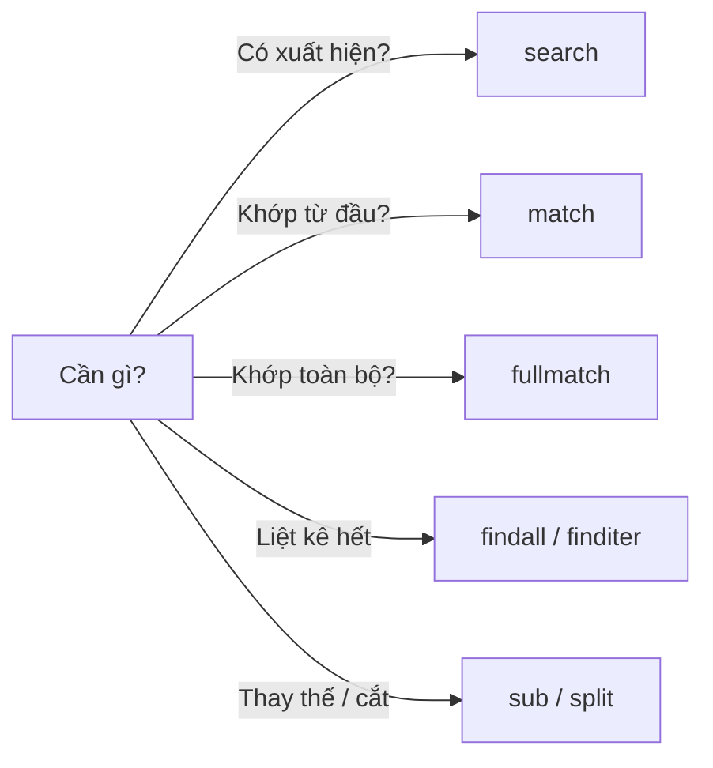

# Bài 23 — Biểu Thức Chính Quy (Regex)

> 📚 **Dãy phẳng b1–b46 — Nền tảng + Thuật toán**

> 🏷️ **Nhóm bài:** Kỹ thuật Python · Regex (biểu thức chính quy)

---

## 🧠 Điều kiện tiên quyết

- [Bài 16 — Chuỗi (String)](../b16-String/bai.md)
- [Bài 8 — Vòng Lặp For](../b08-Vong-Lap-For/bai.md)

---

## 🎯 Mục tiêu

Sau bài học này, học viên sẽ:

* ✅ Hiểu regex là "khuôn mẫu mô tả hình dạng chuỗi" (không phải chuỗi cụ thể).
* ✅ Dùng `search/match/fullmatch/findall/sub/split` đúng chỗ.
* ✅ Đọc/viết được lớp ký tự (`\d \w \s`), lượng từ (`+ * ? {m,n}`), neo (`^ $`).
* ✅ Dùng nhóm `(...)` (đặt tên + lấy ra), `|` (hoặc), raw string `r"..."`.
* ✅ Tránh 2 bẫy lớn: quên raw string và tham lam (greedy) nuốt quá đà.
* ✅ Viết được pattern thực tế: email, số điện thoại, tách dữ liệu bẩn.

---

## 📖 Mở đầu

Kiểm tra "chuỗi này có phải email không" bằng `if` thường: dài dòng, sót case.
Regex (regular expression) cho phép **vẽ khuôn** ("vài chữ + @ + vài chữ + .
+ 2–3 chữ") rồi hỏi máy: "chuỗi này lọt khuôn không?" — 1 dòng thay 20 dòng.

---

## 💡 Ý tưởng trực quan

* **Khuôn bánh:** bột (chuỗi) ép vào khuôn (pattern) — vừa khít thì đạt.
  `\d+` là khuôn "1 hoặc nhiều chữ số": "123" lọt, "12a" không lọt hẳn.
* **`search` vs `match` vs `fullmatch`:** tìm trong nhà (`search`) — đứng ở cửa
  nhìn (`match`, phải khớp từ đầu) — đo cả người vừa khít khung cửa
  (`fullmatch`, khớp toàn bộ).



---

## 📚 Kiến thức

### 1. Ba hàm tìm kiếm — khác nhau đúng 1 chữ!

```python
import re

re.search(r"\d+", "abc123def").group()   # '123' — tìm ĐÂU CŨNG ĐƯỢC
re.match(r"\d+", "123abc").group()       # '123' — phải khớp TỪ ĐẦU
re.match(r"\d+", "abc123")               # None — đầu là chữ, thua ngay
re.fullmatch(r"\d+", "123")              # khớp — toàn bộ là số
re.fullmatch(r"\d+", "12a")              # None — dính chữ a
```

> `.group()` lấy chuỗi khớp được; không khớp thì kết quả là `None`
> (gọi `.group()` trên `None` là crash — kiểm tra trước!).

### 2. Raw string `r"..."` — quy tắc sống còn

Trong regex, `\d` nghĩa là "chữ số". Nhưng trong chuỗi Python thường,
`"\d"`... cũng là `\d` (may mắn), còn `"\b"` là **xuống dòng kiểu cũ**
(backspace), không phải "biên từ"! Dùng `r"..."` để Python **không đụng vào**
dấu `\`:

```python
re.search("\\bcat\\b", "a cat")   # viết 2 gạch, rối mắt, dễ sai
re.search(r"\bcat\b", "a cat")    # ✅ chuẩn: raw string, 1 gạch
```

> Quy tắc: **pattern regex luôn viết trong `r"..."`**. Không có ngoại lệ cho
> người mới.

### 3. Lớp ký tự và lượng từ — 80% regex chỉ cần bảng này

| Mẫu | Nghĩa | Ví dụ khớp |
|---|---|---|
| `\d` | Chữ số 0–9 | "5" |
| `\w` | Chữ/số/gạch dưới | "a", "7", "_" (không khớp dấu cách, @) |
| `\s` | Khoảng trắng | " ", "\t", "\n" |
| `.` | Bất kỳ ký tự nào (trừ xuống dòng) | "a", "5", "@" |
| `[abc]` | 1 trong các ký tự | "b" |
| `[^abc]` | KHÔNG phải các ký tự | "d" |
| `[0-9]`, `[a-z]` | Khoảng | "3", "m" |

| Lượng từ | Nghĩa | `"aaa"` với `a...` |
|---|---|---|
| `+` | 1 hoặc nhiều | `a+` → "aaa" |
| `*` | 0 hoặc nhiều | `a*` → "aaa" |
| `?` | 0 hoặc 1 | `a?` → "a" |
| `{m}` | Đúng m lần | `a{2}` → "aa" |
| `{m,n}` | Từ m đến n lần | `a{2,4}` → "aaa" |

```python
re.findall(r"\d+", "a1b22c333")       # ['1', '22', '333']
re.findall(r"\d{2,4}", "1 22 333")    # ['22', '333']
```

### 4. Neo `^ $` và cờ — khớp ở đâu?

```python
re.search(r"^\d+$", "123")    # khớp (cả chuỗi là số)
re.search(r"^\d+", "123abc")  # khớp "123" (bắt đầu bằng số là đủ)
re.search(r"py", "PYTHON")                    # None (hoa/thường!)
re.search(r"py", "PYTHON", re.IGNORECASE)     # 'PY' ✔
```

`^` = đầu chuỗi, `$` = cuối chuỗi. `re.IGNORECASE` bỏ qua hoa/thường.

### 5. Nhóm `(...)` — lấy từng mảnh ra

```python
m = re.search(r"(?P<ten>\w+)@(?P<dom>[\w.]+)", "lien he an@vidu.vn nhe")
m.group("ten")   # 'an'
m.group("dom")   # 'vidu.vn'
m.group(1)       # 'an' (nhóm theo số thứ tự cũng được)
```

`(?P<ten>...)` đặt tên cho nhóm — đọc code 6 tháng sau vẫn hiểu ngay.

### 6. Thay thế và cắt — `sub` / `split`

```python
re.sub(r"\s+", " ", "a   b\tc")        # 'a b c' (dọn khoảng trắng thừa)
re.split(r"[,;]\s*", "a,b; c")         # ['a', 'b', 'c'] (tách nhiều dấu)
```

### 7. Bẫy tham lam (greedy) — `.+` nuốt quá đà!

```python
re.search(r"<.+>", "<b>day</b>").group()    # '<b>day</b>' — nuốt HẾT!
re.search(r"<.+?>", "<b>day</b>").group()   # '<b>' ✔ (thêm ? = lười)
```

`.+` tham lam: lấy **dài nhất** có thể. Thêm `?` (`+?`, `*?`) thành lười biếng:
lấy **ngắn nhất**. Bóc thẻ HTML/XML mà quên `?` là bug kinh điển!

---

## 💻 Ví dụ

### Ví dụ 1 — Dễ: tìm số điện thoại trong văn bản

```python
import re

van_ban = "Lien he: 0912-345-678 hoac 0987.654.321 nhe!"
sdt = re.findall(r"\d{4}[-.]\d{3}[-.]\d{3}", van_ban)
print(sdt)   # ['0912-345-678', '0987.654.321']
```

Pattern đọc thành tiếng: "4 số, 1 dấu (`-` hoặc `.`), 3 số, 1 dấu, 3 số".
`[-.]` là lớp ký tự (dấu `-` đầu lớp thì hiểu là ký tự thường, không phải khoảng!).

### Ví dụ 2 — Thực tế: kiểm tra email + tách tên miền

```python
import re

def la_email(s):
    return re.fullmatch(r"[\w.]+@[\w.]+\.\w+", s) is not None

def tach_email(s):
    m = re.search(r"(?P<ten>[\w.]+)@(?P<dom>[\w.]+)", s)
    return (m.group("ten"), m.group("dom")) if m else (None, None)

print(la_email("an@vidu.vn"))    # True
print(la_email("an@vidu"))       # False (thiếu .vn)
print(la_email("a b@vidu.vn"))   # False (dính dấu cách)
print(tach_email("gui toi an@vidu.vn nhe"))   # ('an', 'vidu.vn')
```

> 💡 Pattern email trên đủ dùng cho bài tập/form cơ bản. Email chuẩn quốc tế
> (RFC) phức tạp hơn nhiều — production dùng thư viện `email-validator`,
> đừng tự viết pattern "chuẩn tuyệt đối"!

### Ví dụ 3 — Khó: dọn dữ liệu bẩn đa định dạng

> Log ghi tiền kiểu lung tung: `"Tong: 1,244,000d"`, `"Gia 50000"`,
> `"Giam -2,500"`. Trích mọi con số (giữ dấu âm), bỏ dấu phẩy/dấu `d`:

```python
import re

def trich_so(dong):
    thô = re.findall(r"-?[\d,]+", dong)
    return [int(x.replace(",", "")) for x in thô]

assert trich_so("Tong: 1,244,000d") == [1244000]
assert trich_so("Giam -2,500 con 300") == [-2500, 300]
assert trich_so("Khong co so") == []
```

`-?` (âm hoặc không) + `[\d,]+` (số/phẩy) rồi `replace` phẩy — công thức 2 bước
"dùng regex bắt thô, dùng code làm sạch" áp dụng cho mọi dữ liệu bẩn thực tế!

---

## 🔍 Phân tích từng bước (pattern email)

`[\w.]+@[\w.]+\.\w+` với `"an@vidu.vn"`:

| Mảnh pattern | Khớp phần nào |
|---|---|
| `[\w.]+` | "an" (chữ, tham lam lấy hết trước @) |
| `@` | "@" đúng 1 ký tự |
| `[\w.]+` | "vidu.vn" (chữ + chấm đều được!) |
| `\.` |... khoan! `[\w.]+` đã nuốt cả ".vn", còn gì cho `\.\w+`? |

Regex engine **nhả bớt** (backtrack): `[\w.]+` nhả "vn" lại → `\.` khớp ".",
`\w+` khớp "vn" ✔. Backtracking là lý do regex vừa mạnh vừa có thể chậm
(pattern xấu + chuỗi dài = "treo" — gọi là catastrophic backtracking; thi cử
tránh pattern lồng nhau kiểu `(a+)+$`!).

---

## 📊 Minh họa

```
Chuỗi:   a   b   a   b   a
search "aba": thử 0 ✔✔✔ → THẤY ở 0 (không cần KMP ở đây!)
match "b":    đầu là 'a' → None ngay
fullmatch "[a-z]+": cả 5 chữ thường → khớp hết ✔
sub:     "a1b22" --\d+→"X"--> "aXbX"
```

---

## ⚠️ Những lỗi thường gặp

### Lỗi 1: Quên raw string

```python
re.search("\bcat\b", "a cat")    # ❌ \b thành backspace, không khớp!
re.search(r"\bcat\b", "a cat")   # ✅
```

### Lỗi 2: Dùng `match` khi cần `search` (và ngược lại)

* Cần "có xuất hiện ở đâu" mà dùng `match` → `None` oan vì đầu chuỗi khác.
* Cần "cả chuỗi đúng định dạng" (validate form) mà dùng `search` → lọt chuỗi bẩn
  ("abc123" vẫn "có số"!). Validate form luôn dùng **`fullmatch`**.

### Lỗi 3: Tham lam nuốt quá đà (mục 7)

* `<.+>` với `"<b>day</b>"` ra cả cụm. Nhớ `+?` khi bóc thẻ/nội dung ngắn nhất.

### Lỗi 4: Quên `None` khi không khớp

```python
m = re.search(r"\d+", "khong co so")
m.group()   # ❌ AttributeError (crash)!
# ✅:
if m:
    print(m.group())
```

### Lỗi 5: `{2,4}` và biên từ

* `re.findall(r"\d{2,4}", "55555")` → `['5555']` (lấy 4, còn '5' lẻ không đủ) —
  muốn tách số độc lập thì thêm biên: `r"\b\d{2,4}\b"`.

---

## 🧪 Trường hợp đặc biệt

* **Chuỗi rỗng**: `re.search(r"\d*", "")` khớp chuỗi rỗng! (`*` cho phép 0 lần.)
  Muốn "phải có" thì dùng `+`.
* **Xuống dòng**: `.` không khớp `\n` (dùng cờ `re.DOTALL` nếu cần), `^/$` theo
  dòng với `re.MULTILINE`.
* **Unicode**: `\w` khớp cả chữ có dấu Việt Nam ("ệ" ✔) — tiện khi tách từ
  tiếng Việt! (Python 3 mặc định `re.UNICODE` cho `str`.)
* **Hiệu năng**: pattern trong vòng lặp 10⁵ lần → biên dịch 1 lần
  (`mau = re.compile(r"...")` rồi `mau.search(...)`) — nhanh hơn rõ rệt.

---

## 🚀 Ứng dụng thực tế

* Validate form (email, phone, CCCD, mã số thuế), dọn log, tách dữ liệu crawl.
* Tìm/replace hàng loạt trong VSCode (ô tìm kiếm có chế độ regex!).
* Thi HSG: tách số từ đề văn bản, kiểm tra định dạng input.

---

## 🧩 Bài tập

### 🟢 Cơ bản (1–4)

**Bài 1 — search/match/fullmatch.** Với `"abc123"`, cho biết kết quả
(`group()` hoặc `None`) của: `search(r"\d+")`, `match(r"\d+")`,
`fullmatch(r"\d+")`, `match(r"[a-z]+")`, `fullmatch(r"[a-z]+\d+")`.

**Bài 2 — findall số.** Từ `"Ngủ 8h, dậy 6h30, chạy 5km"`, trích mọi số
(kể cả số thập phân? `[\d.]+` có bẫy gì với "6h30" — kiểm tra!).

**Bài 3 — Raw string.** Giải thích vì sao `"\b"` và `r"\b"` khác nhau (in thử
`repr()` cả hai). Viết lại pattern tìm từ "cat" đứng riêng bằng raw string.

**Bài 4 — Lớp ký tự.** Viết pattern khớp: (a) mã lớp "10A1" (2 số + chữ hoa +
số), (b) biển số "51F-1234" (2 số + chữ hoa + `-` + 4 số). Test cả case sai.

### 🟡 Hiểu sâu (5–8)

**Bài 5 — Nhóm đặt tên.** Từ `"DT: 0912-345-678 (Viettel)"`, trích số và nhà
mạng bằng 2 nhóm đặt tên. Code + test.

**Bài 6 — sub dọn văn bản.** `"Tôi   có    2   quả táo!!!"` → `"Tôi có 2 quả
táo!"` (gộp khoảng trắng + gộp dấu `!` lặp). Dùng 2 lần `sub`. Test.

**Bài 7 — split đa dấu.** `"a, b; c  d\te"` tách thành từ (dấu `,;` khoảng trắng
tab). So với `split()` thường (khi nào regex thắng?).

**Bài 8 — Tham lam vs lười.** Với `"<div><p>Hi</p></div>"`, so kết quả
`<.+>` và `<.+?>`. Giải thích từng bước engine (tham lam nuốt hết rồi nhả).

### 🔴 Vận dụng (9–12)

**Bài 9 — Validate CCCD.** CCCD 12 chữ số. Viết hàm kiểm tra (fullmatch +
đúng 12 số). Test (đúng, thiếu số, thừa số, lẫn chữ). Mở rộng: tách 3 phần
(tỉnh/huyện/xã theo quy ước? — tự đặt 3 nhóm `(\d{3})(\d{3})(\d{6})`).

**Bài 10 — Tách bảng điểm.** Văn bản nhiều dòng `"Toan: 8.5, Van: 7"`.
Trích dict {môn: điểm} bằng `findall` nhóm (môn là chữ, điểm là số thập phân).
Test 3 môn.

**Bài 11 — Chống ReDoS mini.** Pattern `(a+)+$` với chuỗi `"aaaa...ab"` (30 chữ
a + b) — đo thời gian (sẽ rất chậm!). Giải thích backtracking bùng nổ và viết
lại an toàn (`^a+$` + kiểm tra riêng). *Cảnh báo: đừng chạy với 50 chữ a!*

**Bài 12 — Mini project: dọn log.** File log các dòng `"[2026-01-01 10:00]
USER An LOGIN"`. Viết chương trình đọc file, trích (ngày, giờ, user, hành động)
bằng regex nhóm đặt tên, in bảng + đếm mỗi user login mấy lần (kết hợp
Counter — ôn Bài 4 nhánh Thuật toán!).

---

## ✅ Đáp án

> 💡 **Hãy tự làm bài tập trước** rồi mới mở đáp án.

<details>
<summary>✅ Bài 1: search/match/fullmatch</summary>

* `search(r"\d+")` → `"123"` (tìm thấy ở giữa).
* `match(r"\d+")` → `None` (đầu là 'a').
* `fullmatch(r"\d+")` → `None` (dính chữ).
* `match(r"[a-z]+")` → `"abc"` (tham lam lấy hết chữ đầu).
* `fullmatch(r"[a-z]+\d+")` → `"abc123"` (chữ + số phủ hết ✔).

</details>

<details>
<summary>✅ Bài 2: findall số</summary>

```python
import re
print(re.findall(r"\d+", "Ngủ 8h, dậy 6h30, chạy 5km"))
# ['8', '6', '30', '5'] — "6h30" tách thành 6 và 30!
```

`[\d.]+` còn tệ hơn: "6h30" → "6", "30" (chấm không dính vì có h ở giữa —
thực ra vẫn tách!). Muốn "6h30" nguyên cụm phải viết pattern giờ cụ thể:
`r"\d+h\d+"`. Bài học: **pattern chung chung tách sai dữ liệu có cấu trúc** —
hiểu dữ liệu rồi mới viết pattern!

</details>

<details>
<summary>✅ Bài 3: Raw string</summary>

```python
print(repr("\b"))    # '\x08' (backspace!) — Python dịch \b trước
print(repr(r"\b"))   # '\\b' (giữ nguyên 2 ký tự \ và b)
re.search(r"\bcat\b", "a cat and catty").group()  # 'cat' (từ đứng riêng)
```

`\b` trong regex = "biên từ" (giữa chữ và không-chữ). Không raw string thì
Python "ăn" mất dấu `\` trước khi regex nhìn thấy!

</details>

<details>
<summary>✅ Bài 4: Lớp ký tự</summary>

```python
import re
lop = r"^\d{2}[A-Z]\d$"
bienso = r"^\d{2}[A-Z]-\d{4}$"
assert re.fullmatch(lop, "10A1")
assert not re.fullmatch(lop, "1A1")     # thiếu 1 số
assert re.fullmatch(bienso, "51F-1234")
assert not re.fullmatch(bienso, "51F-123")  # thiếu 1 số
```

`[A-Z]` chỉ chữ HOA (không gồm thường!). Validate form luôn `fullmatch` +
`^...$` (thừa 1 cái vẫn chắc).

</details>

<details>
<summary>✅ Bài 5: Nhóm đặt tên</summary>

```python
import re
m = re.search(r"(?P<so>\d[\d.-]+\d)\s*\((?P<mang>\w+)\)",
              "DT: 0912-345-678 (Viettel)")
assert (m.group("so"), m.group("mang")) == ("0912-345-678", "Viettel")
```

`\d[\d.-]+\d`: bắt đầu/kết thúc bằng số, giữa là số/dấu. Nhóm đặt tên `so`,
`mang` — đọc đáp án 6 tháng sau vẫn hiểu!

</details>

<details>
<summary>✅ Bài 6: sub dọn văn bản</summary>

```python
import re
s = "Tôi   có    2   quả táo!!!"
s = re.sub(r"\s+", " ", s)   # 'Tôi có 2 quả táo!!!'
s = re.sub(r"!+", "!", s)    # 'Tôi có 2 quả táo!'
assert s == "Tôi có 2 quả táo!"
```

Thứ tự quan trọng: gộp khoảng trắng trước (không ảnh hưởng `!`), rồi gộp `!`.
Mỗi `sub` làm đúng 1 việc — dễ đọc, dễ test riêng!

</details>

<details>
<summary>✅ Bài 7: split đa dấu</summary>

```python
import re
assert re.split(r"[,;\s]+", "a, b; c  d\te") == ["a", "b", "c", "d", "e"]
```

`split()` thường chỉ tách khoảng trắng (không tách được `,`/`;`).
Regex thắng khi **nhiều loại dấu trộn lẫn**. Chỉ khoảng trắng đơn giản thì
`split()` nhanh và đủ — đừng lạm dụng regex!

</details>

<details>
<summary>✅ Bài 8: Tham lam vs lười</summary>

* `<.+>`: `.+` nuốt tới `>` CUỐI cùng → `"<div><p>Hi</p></div>"` (cả cụm!).
* `<.+?>`: lười, dừng ở `>` ĐẦU tiên → `"<div>"`.
* Engine tham lam: lấy dài nhất → thử → không khớp tổng thể → **nhả bớt 1 ký
  tự** → thử lại... lặp đến khi khớp. Với chuỗi lồng nhau, số lần nhả bùng nổ
  (ôn Bài 9 ReDoS!).

</details>

<details>
<summary>✅ Bài 9: Validate CCCD</summary>

```python
import re

def la_cccd(s):
    return re.fullmatch(r"\d{12}", s) is not None

def tach_cccd(s):
    m = re.fullmatch(r"(\d{3})(\d{3})(\d{6})", s)
    return m.groups() if m else None

assert la_cccd("079123456789")
assert not la_cccd("07912345678")    # 11 số
assert not la_cccd("0791234567890")  # 13 số
assert not la_cccd("07912345678a")   # lẫn chữ
assert tach_cccd("079123456789") == ("079", "123", "456789")
```

</details>

<details>
<summary>✅ Bài 10: Tách bảng điểm</summary>

```python
import re

def tach_diem(van_ban):
    return {mon: float(diem) for mon, diem in
            re.findall(r"([A-Za-zÀ-ỹ]+):\s*(\d+(?:\.\d+)?)", van_ban)}

assert tach_diem("Toan: 8.5, Van: 7, Anh: 9") == {"Toan": 8.5, "Van": 7.0, "Anh": 9.0}
```

`[A-Za-zÀ-ỹ]+` khớp cả tên môn có dấu ("Ngữ văn" — nhưng có dấu cách thì gãy!
Muốn tên 2 từ: `[\wÀ-ỹ ]+?` + tinh chỉnh — bài tập mở cho bạn!).
`(\d+(?:\.\d+)?)`: số nguyên hoặc thập phân (`(?:...)` là nhóm KHÔNG bắt —
không làm bẩn kết quả `findall`!).

</details>

<details>
<summary>✅ Bài 11: Chống ReDoS mini</summary>

```python
import time
pat = re.compile(r"(a+)+$")
s = "a" * 25 + "b"
t0 = time.perf_counter()
pat.search(s)   # KHÔNG khớp (tận cùng b) nhưng engine thử mọi cách chia nhóm!
t1 = time.perf_counter()
print(f"{t1 - t0:.2f}s")   # ~vài giây với 25 chữ a; 30 chữ a có thể > 1 phút!
```

`(a+)+`: mỗi chữ a vừa thuộc `a+` trong vừa thuộc `+` ngoài → 2ⁿ cách chia
nhóm, engine thử hết trước khi chịu thua! Viết lại an toàn:

```python
def toan_a(s):
    return re.fullmatch(r"a+", s) is not None   # O(n), không lồng nhau
```

Quy tắc: **không bao giờ lồng lượng từ** (`(... + ...)+`, `(a*)*`)!

</details>

<details>
<summary>✅ Bài 12: Mini project dọn log</summary>

```python
import re
from collections import Counter
from pathlib import Path

MAU = re.compile(r"\[(?P<ngay>\d{4}-\d{2}-\d{2}) (?P<gio>\d{2}:\d{2})\]\s+"
                 r"USER (?P<user>\w+) (?P<hanh_dong>\w+)")

def doc_log(duong_dan):
    ket_qua = []
    for dong in Path(duong_dan).read_text(encoding="utf-8").splitlines():
        m = MAU.search(dong)
        if m:
            ket_qua.append(m.groupdict())
    return ket_qua

# dòng không khớp mẫu thì BỎ QUA (log thật luôn có dòng rác!) — không crash
```

Test: tạo file 3 dòng mẫu (2 LOGIN của An, 1 của Binh) → đếm Counter:
`{"An": 2, "Binh": 1}` ✔. `re.compile` 1 lần ngoài vòng lặp (hiệu năng!) +
`groupdict()` trả dict sẵn — combo chuẩn xử lý log thật!

</details>

---

## 🧠 Thử thách

**Thử thách HSG:** Viết tokenizer mini cho biểu thức số học: tách `"3 + 4*2-(1+5)"`
thành `['3', '+', '4', '*', '2', '-', '(', '1', '+', '5', ')']` bằng **1 biểu thức
duy nhất** với `findall` + nhóm xen kẽ (`\d+|[+*/()-]`). Rồi mở rộng: số thập phân
(`\d+\.\d+|\d+`), bỏ khoảng trắng trước (`re.sub(r"\s+", "", s)`). Đây là bước đầu
viết trình thông dịch — máy tính "đọc" code cũng bắt đầu từ tokenize!

---

## 📝 Tóm tắt

| Khái niệm | Nội dung |
|---|---|
| 🔍 search/match/fullmatch | Tìm đâu cũng được / từ đầu / toàn bộ |
| 📝 r"..." | Raw string — luật sống còn của regex |
| 🔤 \d \w \s . [] | Lớp ký tự + lượng từ +*?{m,n} |
| 📍 ^ $ + IGNORECASE | Neo + cờ |
| 👥 Nhóm (...) | Lấy mảnh ra, đặt tên càng tốt |
| 🔄 sub/split | Thay thế, cắt đa dấu |
| 🦥 Greedy vs lazy | `.+` nuốt hết, `.+?` dừng sớm |

---

## 🏠 Bài tập về nhà

> 📝 Làm vào vở (hoặc nộp GV). Đáp án chi tiết sẽ bổ sung trong đợt hoàn thiện.

1. **Sổ lọc dữ liệu:** cho câu lộn xộn "AN: 038-1234, binh: 091-9999", trích tất cả số điện thoại dạng `0xx-xxxx` bằng regex.
2. **Dọn log:** cho 10 dòng log "[SỐ] nội dung", tách riêng số hiệu và nội dung (dùng nhóm đặt tên).
3. **Kiểm tra mật khẩu:** viết pattern cho mật khẩu ≥ 8 ký tự, có chữ và số; giải thích từng mảnh pattern của bạn.

---

## 📎 Tra cứu nhanh — Regex — cú pháp & hàm thường dùng

| Nhóm | Mẫu | Ý nghĩa | Ví dụ |
|---|---|---|---|
| Lớp ký tự | `\d` `\w` `\s` `.` | số / chữ+số / trắng / bất kỳ | `\d+` chuỗi số |
| Lớp tùy chọn | `[abc]` `[^abc]` `[a-z]` | thuộc / không thuộc / khoảng | |
| Lượng từ | `*` `+` `?` `{m,n}` | 0+ / 1+ / 0-1 / m..n lần | |
| Neo | `^` `$` | đầu / cuối | `^0\d{9}$` số ĐT |
| Nhóm | `(...)` `(?P<ten>...)` | nhóm lấy ra / nhóm đặt tên | |
| Hoặc | `cat\|dog` | một trong hai | |
| Hàm | `re.search(p, s)` | Tìm khắp chuỗi, trả match đầu | Kiểm tra tồn tại |
| Hàm | `re.match / re.fullmatch` | Khớp từ đầu / khớp trọn | |
| Hàm | `re.findall(p, s)` | List mọi kết quả khớp nhóm | Trích số ĐT |
| Hàm | `re.sub(p, thay, s)` | Thay thế | Dọn ký tự lạ |
| Hàm | `re.split(p, s)` | Cắt theo mẫu | Cắt đa dấu |

**Ghi nhớ:** luôn dùng **raw string** `r"..."`; lượng từ mặc định tham lam (greedy) — thêm `?` để lười; `flags=re.IGNORECASE` bỏ phân biệt hoa thường.

---

## ➡️ Điều hướng

**Vị trí:** `b23-Regex/bai.md`

**Bài tiếp theo:** [Bài 24 — Tư Duy Thuật Toán](../b24-Tu-Duy-Thuat-Toan/bai.md)

👉 Tiếp theo: **[Bài 24: Tư Duy Thuật Toán](../b24-Tu-Duy-Thuat-Toan/bai.md)**

🏆 **Bạn đã hoàn thành Phần 1 — Nền tảng (Bài 1–23)!** Tiếp tục ngay với:
- 🧮 [Phần 2 — Thuật Toán (HSG/CP)](../b24-Tu-Duy-Thuat-Toan/bai.md) — từ **Bài 24 — Tư Duy Thuật Toán** tới **Bài 46 — Lý Thuyết Trò Chơi**.