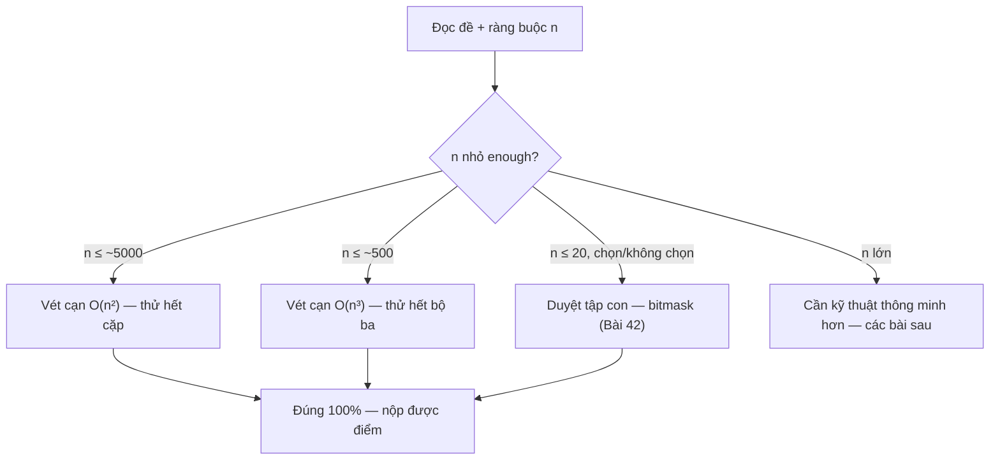

# Bài 26 — Vét Cạn (Brute Force)

> 📚 **Dãy phẳng b1–b46 — Nền tảng + Thuật toán**

> 🏷️ **Nhóm bài:** Kỹ thuật giải thuật cơ bản · **Mức độ:** ⭐⭐

---

## 🧠 Điều kiện tiên quyết

- [Bài 24 — Tư Duy Thuật Toán](../b24-Tu-Duy-Thuat-Toan/bai.md)
- [Bài 25 — Độ Phức Tạp & Big-O](../b25-Do-Phuc-Tap/bai.md)
- [Bài 8 — Vòng Lặp For](../b08-Vong-Lap-For/bai.md)
- [Bài 12 — Danh Sách (List)](../b12-List/bai.md)

---

## 🎯 Mục tiêu

Sau bài học này, học viên sẽ:

* ✅ Hiểu **vét cạn (brute force)** là gì: thử **hết mọi khả năng** rồi chọn đáp án đúng nhất.
* ✅ Viết được 3 khuôn mẫu vét cạn chuẩn: **một vòng**, **hai vòng**, **ba vòng / liệt kê tổ hợp**.
* ✅ Biết cách **đọc ràng buộc `n`** để quyết định vét cạn có "sống sót" không (nối tiếp Bài 25).
* ✅ Áp dụng **cắt tỉa sớm** (`break`, `continue`, kiểm tra biên) để vét cạn nhanh hơn.
* ✅ Biết vai trò quan trọng của vét cạn: làm **bản đối chiếu (stress test)** để kiểm chứng thuật toán nhanh.

---

## 📖 Mở đầu

Khi mới giải bài thuật toán, câu hỏi đầu tiên không phải "thuật toán gì xịn nhất", mà là:
**"Mình có thể thử hết mọi khả năng không?"**

Nếu đề cho `n` nhỏ (vài nghìn trở xuống), câu trả lời thường là **có** — và đó là lúc **vét cạn** tỏa sáng:

* Không cần suy nghĩ phức tạp — chỉ cần liệt kê đủ mọi khả năng.
* **Đúng 100%** (nếu liệt kê đủ!) — không sợ sai thuật toán.
* Là **nền tảng tư duy**: mọi thuật toán thông minh hơn đều được kiểm chứng bằng một bản vét cạn.

Vét cạn giống như cách bạn mở chiếc khóa số quên mật mã: thử lần lượt 000, 001, 002...
Nghe "ngốc" nhưng **chắc chắn mở được** — miễn số khả năng đủ nhỏ để thử hết.

---

## 💡 Ý tưởng trực quan

* **Thử từng chìa:** không đoán chìa nào mở được — lấy lần lượt **tất cả** chìa ra thử.
* **Trọng tài không bao giờ sai:** vét cạn là "trọng tài" — chậm nhưng luôn đưa ra đáp án đúng,
  dùng để **kiểm tra lại** các lời giải nhanh hơn.
* **Đếm ngược `n`:** vét cạn "kham" được bao nhiêu? Phụ thuộc số vòng lặp:

| Số vòng lặp | Độ phức tạp | `n` tối đa "sống sót" (≈1 giây Python) |
|---|---|---|
| 1 vòng | O(n) | ~10⁷–10⁸ |
| 2 vòng lồng | O(n²) | ~3.000–5.000 |
| 3 vòng lồng | O(n³) | ~300–500 |
| Liệt kê mọi tập con | O(2ⁿ) | n ≤ ~20 |
| Liệt kê mọi hoán vị | O(n!) | n ≤ ~10 |

---

## 📚 Kiến thức

### 1. Vét cạn là gì?

**Vét cạn (brute force)** = duyệt hết mọi khả năng có thể, kiểm tra từng khả năng, chọn khả năng thỏa đề.

```python
# Ví dụ: tìm số lớn nhất trong dãy — vét cạn "1 vòng"
a = [5, 2, 9, 1, 7]
lon_nhat = a[0]
for x in a:          # thử hết mọi phần tử
    if x > lon_nhat:
        lon_nhat = x
print(lon_nhat)      # 9
```

Thực ra "vét cạn" có ở khắp nơi — kể cả những đoạn code bạn viết từ đầu khóa tới giờ!
Điểm khác biệt: từ bài này, ta **gọi tên** nó và chủ động dùng nó như một **chiến lược**.

### 2. Đọc ràng buộc trước khi vét cạn

Nguyên tắc vàng (ôn Bài 25): **đọc `n` trước, chọn thuật toán sau**.

* `n ≤ 100` → nghĩ thẳng tới **3 vòng lặp** O(n³) cũng ổn.
* `n ≤ 5.000` → **2 vòng lặp** O(n²) là đẹp.
* `n ≤ 10⁵` trở lên → hãy cẩn thận: O(n²) = 10¹⁰ phép tính → **TLE**; cần kỹ thuật thông minh hơn (các bài sau).
* `n ≤ 20` và đề kiểu "chọn/không chọn" → nghĩ ngay tới **duyệt tập con** (bitmask — Bài 42).

> ⚠️ **Vét cạn không có nghĩa là "kém"** — nó là bước 1 của mọi lời giải:
> viết vét cạn trước để có đáp án đúng, rồi mới tối ưu nếu cần.

### 3. Khuôn mẫu 1 — một vòng lặp

Dùng khi: đáp án chỉ cần **quét một lượt** (tìm max/min, đếm, kiểm tra tồn tại).

```python
dem = 0
for x in a:
    if x % 2 == 0:
        dem += 1
```

### 4. Khuôn mẫu 2 — hai vòng lặp (duyệt cặp)

Dùng khi: đáp án liên quan tới **một cặp** `(i, j)` — "tìm 2 số...", "đếm cặp...", "khoảng cách giữa 2 điểm...".

```python
# Đếm số cặp (i < j) có tổng chẵn
n = len(a)
dem = 0
for i in range(n):
    for j in range(i + 1, n):    # ⚠️ j bắt đầu từ i + 1 — tránh tự ghép và lặp cặp
        if (a[i] + a[j]) % 2 == 0:
            dem += 1
print(dem)
```

> 💡 **Mẹo nhớ:** cặp `(i, j)` không phân biệt thứ tự → cho `j` chạy từ `i + 1`.
> Nếu đề quan tâm thứ tự (a→b khác b→a) thì mới cho `j` chạy từ 0 (trừ `j == i`).

### 5. Khuôn mẫu 3 — ba vòng lặp / liệt kê tổ hợp

Khi đề hỏi **bộ ba**, hoặc "chọn k phần tử từ n":

```python
# Tìm bộ ba a[i] + a[j] + a[k] == 0 đầu tiên (i < j < k)
tim_thay = False
for i in range(n):
    for j in range(i + 1, n):
        for k in range(j + 1, n):
            if a[i] + a[j] + a[k] == 0:
                print(a[i], a[j], a[k])
                tim_thay = True
                break
        if tim_thay: break
    if tim_thay: break
```

Với "chọn k phần tử bất kỳ" (tổ hợp), Python có sẵn — không cần tự viết k vòng lặp:

```python
from itertools import combinations
for bo in combinations(a, 3):     # mọi bộ 3 phần tử
    if sum(bo) == 0:
        print(bo)
```

### 6. Cắt tỉa sớm — làm vét cạn nhanh hơn

Vét cạn ≠ "chạy hết vô điều kiện". Luôn thoát sớm khi đã chắc chắn:

```python
# Tìm cặp đầu tiên có tổng bằng K — tìm thấy là DỪNG, không cần duyệt tiếp
for i in range(n):
    for j in range(i + 1, n):
        if a[i] + a[j] == K:
            print(i, j)
            raise SystemExit        # hoặc dùng cờ + break 2 tầng như trên
```

Các kiểu cắt tỉa thường dùng:
* Tìm thấy đáp án → **dừng ngay** (bài "tìm/tồn tại").
* Loại sớm: `if a[i] > K: continue` khi biết chắc không thể đúng.
* Với bài "đếm": không cắt được (phải đếm hết) — nhưng có thể thêm điều kiện lọc rẻ tiền trước.

### 7. Vai trò "trọng tài" — vét cạn để kiểm chứng

Đây là kỹ năng **quan trọng bậc nhất khi luyện thi**:

1. Viết lời giải nhanh (tối ưu) — `nhanh(a)`.
2. Viết lời giải vét cạn — `vet_can(a)` (chắc chắn đúng, vì thử hết).
3. Sinh dữ liệu ngẫu nhiên nhỏ, chạy **cả hai**, so kết quả:

```python
import random
for _ in range(1000):
    n = random.randint(1, 8)
    a = [random.randint(-5, 5) for _ in range(n)]
    if nhanh(a) != vet_can(a):
        print("SAI RỒI!", a, nhanh(a), vet_can(a))
        break
else:
    print("OK — 1000 test khớp")
```

Kỹ thuật này gọi là **stress test** (sẽ dùng lại ở Bài 44 — Chiến Lược Thi HSG).

---

## 💻 Ví dụ

### Ví dụ 1 — Dễ: đếm cặp tổng chẵn

> Đề: Cho dãy `n ≤ 3.000` số nguyên. Đếm số cặp chỉ số `i < j` sao cho `a[i] + a[j]` là số chẵn.

```python
n = int(input())
a = list(map(int, input().split()))

dem = 0
for i in range(n):
    for j in range(i + 1, n):
        if (a[i] + a[j]) % 2 == 0:
            dem += 1
print(dem)
```

**Phân tích:** O(n²) → với n = 3.000 là ~4,5 triệu phép tính — chạy tốt trong 1 giây.
Đây là ví dụ "ranh giới": n = 10⁵ sẽ TLE → cần mẹo đếm theo chẵn/lẻ (đáp án của bài tập 9!).

### Ví dụ 2 — Trung bình: đoạn con liên tiếp có tổng lớn nhất (bản vét cạn)

```python
n = int(input())
a = list(map(int, input().split()))

tot_nhat = a[0]
for i in range(n):               # đoạn bắt đầu tại i
    tong = 0
    for j in range(i, n):        # đoạn kết thúc tại j
        tong += a[j]             # CẢI TIẾN: cộng dồn thay vì sum() lại từ đầu
        if tong > tot_nhat:
            tot_nhat = tong
print(tot_nhat)
```

**Phân tích:** Bản "ngây thơ" 3 vòng lặp (i, j, cộng lại từ đầu) là O(n³);
bản này **cộng dồn** khi mở rộng `j` → chỉ còn **O(n²)**. Cùng một ý tưởng vét cạn,
tối ưu nhỏ mà nhanh hơn cả chục lần — bài học lớn!

### Ví dụ 3 — Khó: bộ ba tổng bằng 0 (bản vét cạn)

> Đề: Cho `n ≤ 300` số nguyên. Tìm bộ ba `i < j < k` đầu tiên (theo thứ tự từ điển chỉ số)
> sao cho `a[i] + a[j] + a[k] == 0`.

```python
n = int(input())
a = list(map(int, input().split()))

xong = False
for i in range(n):
    for j in range(i + 1, n):
        for k in range(j + 1, n):
            if a[i] + a[j] + a[k] == 0:
                print(i, j, k)
                xong = True
                break
        if xong: break
    if xong: break
if not xong:
    print("KHONG CO")
```

**Phân tích:** O(n³) → n = 300 là ~4,5 triệu tổ hợp — chạy được.
`break` 2 tầng cần biến cờ `xong` (Python không có `break 2`).
Với n = 10⁵ bài này cần kỹ thuật hai con trỏ / hash — xem Bài 33.

---

## 📊 Minh họa

Tư duy chọn chiến lược — vét cạn là nhánh đầu tiên:



---

## ⚠️ Những lỗi thường gặp

### Lỗi 1: Vét cạn khi n quá lớn (không đọc ràng buộc)

```python
n = 100000
for i in range(n):
    for j in range(i + 1, n):   # ❌ 5 tỷ phép — TLE chắc chắn
```

* **Cách sửa:** đọc `n` trước; n ≥ 10⁵ với 2 vòng lặp → tìm kỹ thuật khác.

### Lỗi 2: Cho `j` chạy từ 0 (đếm trùng cặp)

```python
for i in range(n):
    for j in range(n):          # ❌ đếm (i,j) lẫn (j,i) và cả (i,i)
```

* **Cách sửa:** `j` chạy từ `i + 1` khi đề hỏi cặp không thứ tự.

### Lỗi 3: Quên "không tìm thấy"

```python
for i in range(n):
    for j in range(i + 1, n):
        if a[i] + a[j] == K:
            print(i, j)
# ❌ nếu không có cặp nào — chương trình in gì? Không gì cả — nhưng đề có thể yêu cầu "KHONG CO"
```

* **Cách sửa:** dùng cờ `tim_thay` và xử lý trường hợp không tìm thấy.

### Lỗi 4: So sánh `sum()` lại từ đầu trong vòng lặp

```python
for i in range(n):
    for j in range(i, n):
        if sum(a[i:j+1]) > tot_nhat:   # ❌ mỗi lần cộng lại O(n) → tổng O(n³)
```

* **Cách sửa:** cộng dồn khi mở rộng `j` (xem Ví dụ 2).

---

## 🧪 Trường hợp đặc biệt

* **n = 1** (bài đếm cặp): không có cặp nào → đáp án 0 — vòng `for j` không chạy, đúng tự nhiên.
* **Trùng giá trị:** "cặp chỉ số" khác "cặp giá trị" — đọc kỹ đề! Đếm cặp chỉ số không cần lọc trùng.
* **Số âm:** không ảnh hưởng tới duyệt cặp; nhưng cẩn thận khi so sánh `max` với `0` (bài tổng đoạn).
* **Đáp án xuất hiện nhiều lần:** đề "in bộ đầu tiên" → cắt tỉa sớm; đề "đếm hết" → duyệt hết.

---

## 🚀 Ứng dụng thực tế

* **Kiểm chứng thuật toán (stress test):** bản vét cạn chạy trên dữ liệu nhỏ để bắt lỗi lời giải nhanh — dùng hằng ngày khi thi.
* **Bài toán nhỏ trong dự án thật:** chọn đội hình, lịch khởi hành, cấu hình tốt nhất — với không gian nhỏ, thử hết là nhanh nhất để code.
* **Sinh dữ liệu test:** vét cạn tạo brute answers cho bộ dữ liệu kiểm thử.

---

## 🧩 Bài tập

### Bài 1: Cài đặt cơ bản Brute Force Brute Force

* **Đề bài:** Viết hàm Brute Force_basic thực hiện tìm max/min.
* **Input:** (theo đề bài)
* **Output:** (theo đề bài)
* **Gợi ý:** Cài đặt theo định nghĩa.

### Bài 2: Trace code Brute Force Brute Force

* **Đề bài:** Trace code: cho đoạn code mẫu Brute Force, hãy viết ra kết quả.
* **Input:** (theo đề bài)
* **Output:** (theo đề bài)
* **Gợi ý:** Chạy thủ từng bước.

### Bài 3: Điền khuyết Brute Force Brute Force

* **Đề bài:** Hoàn thiện hàm Brute Force đã cho sẵn.
* **Input:** (theo đề bài)
* **Output:** (theo đề bài)
* **Gợi ý:** Hoàn thiện code còn thiếu.

### Bài 4: So sánh Brute Force Brute Force

* **Đề bài:** So sánh 2 cách giải cho Vét cạn.
* **Input:** (theo đề bài)
* **Output:** (theo đề bài)
* **Gợi ý:** So sánh ưu nhược điểm.

### Bài 5: Áp dụng trực tiếp Brute Force Brute Force

* **Đề bài:** Áp dụng thuật toán Brute Force trực tiếp.
* **Input:** (theo đề bài)
* **Output:** (theo đề bài)
* **Gợi ý:** Áp dụng trực tiếp thuật toán.

### Bài 6: Biến thể đơn giản Brute Force Brute Force

* **Đề bài:** Viết biến thể đơn giản của Brute Force.
* **Input:** (theo đề bài)
* **Output:** (theo đề bài)
* **Gợi ý:** Thay đổi tham số nhỏ.

### Bài 7: Debug Brute Force Brute Force

* **Đề bài:** Sửa lỗi trong code Brute Force cho trước.
* **Input:** (theo đề bài)
* **Output:** (theo đề bài)
* **Gợi ý:** Sửa try/except.

### Bài 8: Độ phức tạp Brute Force Brute Force

* **Đề bài:** Tính độ phức tạp O() của Brute Force.
* **Input:** (theo đề bài)
* **Output:** (theo đề bài)
* **Gợi ý:** Đếm phép toán.

### Bài 9: Kiểm tra hiểu Brute Force Brute Force

* **Đề bài:** Giải thích bước quan trọng của Brute Force.
* **Input:** (theo đề bài)
* **Output:** (theo đề bài)
* **Gợi ý:** Giải thích logic.

### Bài 10: Mở rộng Brute Force Brute Force

* **Đề bài:** Mở rộng Brute Force cho trường hợp mới.
* **Input:** (theo đề bài)
* **Output:** (theo đề bài)
* **Gợi ý:** Mở rộng tham số.

### Bài 11: Cài đặt đầy đủ Brute Force

* **Đề bài:** Viết chương trình hoàn chỉnh cho Brute Force.
* **Input:** (theo đề bài)
* **Output:** (theo đề bài)
* **Gợi ý:** Viết full code.

### Bài 12: Biến thể Brute Force

* **Đề bài:** Sửa thuật toán Brute Force.
* **Input:** (theo đề bài)
* **Output:** (theo đề bài)
* **Gợi ý:** Sửa logic core.

### Bài 13: Tối ưu hóa Brute Force

* **Đề bài:** Cải tiến độ phức tạp của Brute Force.
* **Input:** (theo đề bài)
* **Output:** (theo đề bài)
* **Gợi ý:** Cải tiến cấu trúc dữ liệu.

### Bài 14: Kết hợp Brute Force

* **Đề bài:** Kết hợp Brute Force với thuật toán khác.
* **Input:** (theo đề bài)
* **Output:** (theo đề bài)
* **Gợi ý:** Kết hợp 2 hàm.

### Bài 15: Trace phức tạp Brute Force

* **Đề bài:** Chạy trace thủ công cho Brute Force.
* **Input:** (theo đề bài)
* **Output:** (theo đề bài)
* **Gợi ý:** Viết nhật ký chạy.

### Bài 16: Biến thể ngược Brute Force

* **Đề bài:** Tìm input từ output cho Brute Force.
* **Input:** (theo đề bài)
* **Output:** (theo đề bài)
* **Gợi ý:** Ngược logic.

### Bài 17: Giới hạn lớn Brute Force

* **Đề bài:** Xử lý n lớn cho Brute Force.
* **Input:** (theo đề bài)
* **Output:** (theo đề bài)
* **Gợi ý:** Dùng cấu trúc dữ liệu phù hợp.

### Bài 18: So sánh thực tế Brute Force

* **Đề bài:** So sánh thực tế các thuật toán.
* **Input:** (theo đề bài)
* **Output:** (theo đề bài)
* **Gợi ý:** Dùng timeit.

### Bài 19: Mở rộng Brute Force

* **Đề bài:** Mở rộng Brute Force.
* **Input:** (theo đề bài)
* **Output:** (theo đề bài)
* **Gợi ý:** Thêm tham số.

### Bài 20: Áp dụng thực tế Brute Force

* **Đề bài:** Áp dụng Brute Force vào thực tế.
* **Input:** (theo đề bài)
* **Output:** (theo đề bài)
* **Gợi ý:** Áp dụng thực tế.

### Bài 21: Thiết kế thuật toán Brute Force

* **Đề bài:** Thiết kế thuật toán O() cho Brute Force.
* **Input:** (theo đề bài)
* **Output:** (theo đề bài)
* **Gợi ý:** Tham khảo CLRS.

### Bài 22: Chứng minh Brute Force

* **Đề bài:** Chứng minh đúng đắn cho Brute Force.
* **Input:** (theo đề bài)
* **Output:** (theo đề bài)
* **Gợi ý:** Dùng exchange argument.

### Bài 23: Giới hạn dưới Brute Force

* **Đề bài:** Chứng minh lower bound cho Brute Force.
* **Input:** (theo đề bài)
* **Output:** (theo đề bài)
* **Gợi ý:** Dùng adversary argument.

### Bài 24: Tối ưu cực hạn Brute Force

* **Đề bài:** Tối ưu Brute Force chạy trong time limit.
* **Input:** (theo đề bài)
* **Output:** (theo đề bài)
* **Gợi ý:** Profile + tối ưu.

### Bài 25: Biến thể nghiên cứu Brute Force

* **Đề bài:** Viết biến thể của Brute Force.
* **Input:** (theo đề bài)
* **Output:** (theo đề bài)
* **Gợi ý:** Tham khảo paper.

### Bài 26: Kết hợp nâng cao Brute Force

* **Đề bài:** Kết hợp 3 thuật toán cho Brute Force.
* **Input:** (theo đề bài)
* **Output:** (theo đề bài)
* **Gợi ý:** Phân chia rõ ràng.

### Bài 27: Đối kháng Brute Force

* **Đề bài:** Viết generator test phá Brute Force.
* **Input:** (theo đề bài)
* **Output:** (theo đề bài)
* **Gợi ý:** Sinh test adversarial.

### Bài 28: Mở rộng lý thuyết Brute Force

* **Đề bài:** Mở rộng định lý cho Brute Force.
* **Input:** (theo đề bài)
* **Output:** (theo đề bài)
* **Gợi ý:** Generalize định lý.

### Bài 29: Cài đặt production Brute Force

* **Đề bài:** Cài Brute Force production-ready.
* **Input:** (theo đề bài)
* **Output:** (theo đề bài)
* **Gợi ý:** Production checklist.

### Bài 30: Nghiên cứu mở Brute Force

* **Đề bài:** Đề xuất cải tiến mới cho Brute Force.
* **Input:** (theo đề bài)
* **Output:** (theo đề bài)
* **Gợi ý:** Đọc paper mới.


## ✅ Đáp án

> 💡 **Hãy tự làm bài tập trước** rồi mới mở đáp án.

<details>
<summary>✅ Bài 1: Tìm max bằng vét cạn</summary>

```python
n = int(input())
a = list(map(int, input().split()))
lon_nhat = a[0]
for x in a:
    if x > lon_nhat:
        lon_nhat = x
print(lon_nhat)
```

Duyệt hết một lượt — O(n). Đây chính là "vét cạn 1 vòng": thử mọi phần tử, giữ lại tốt nhất.

</details>

<details>
<summary>✅ Bài 2: Đếm số chẵn</summary>

```python
dem = 0
for x in a:
    if x % 2 == 0:
        dem += 1
print(dem)
```

O(n) — đủ nhanh cho n ≤ 10⁵.

</details>

<details>
<summary>✅ Bài 3: Kiểm tra tồn tại</summary>

```python
co = False
for x in a:
    if x == K:
        co = True
        break        # ✂️ cắt tỉa: tìm thấy là dừng
print("CO" if co else "KHONG")
```

`break` giúp dừng sớm — bài "tồn tại" luôn cắt tỉa được.

</details>

<details>
<summary>✅ Bài 4: Đếm cặp hiệu bằng K</summary>

```python
dem = 0
for i in range(n):
    for j in range(i + 1, n):
        if a[j] - a[i] == K:
            dem += 1
print(dem)
```

Chú ý chiều: `a[j] - a[i]` (j sau i). O(n²) — ok với n ≤ 5.000.

</details>

<details>
<summary>✅ Bài 5: Cặp gần nhất</summary>

```python
tot_nhat = None
for i in range(n):
    for j in range(i + 1, n):
        d = abs((a[i] + a[j]) - K)
        if tot_nhat is None or d < tot_nhat:
            tot_nhat = d
            cap = (i, j)
print(*cap, tot_nhat)
```

Giữ "cặp tốt nhất tới giờ" khi duyệt — mẫu chuẩn của mọi vét cạn tìm min/max.

</details>

<details>
<summary>✅ Bài 6: Bộ ba đếm được</summary>

```python
dem = 0
for i in range(n):
    for j in range(i + 1, n):
        for k in range(j + 1, n):
            if a[i] < a[j] < a[k]:
                dem += 1
print(dem)
```

O(n³), n ≤ 200 → khoảng 1,3 triệu bộ ba — chạy tốt.

</details>

<details>
<summary>✅ Bài 7: Đoạn con tổng bằng K (đếm)</summary>

```python
dem = 0
for i in range(n):
    tong = 0
    for j in range(i, n):
        tong += a[j]           # cộng dồn — tránh sum() lặp lại
        if tong == K:
            dem += 1
print(dem)
```

O(n²) với cộng dồn. (n = 10⁵ cần hash tổng tiền tố — Bài 33.)

</details>

<details>
<summary>✅ Bài 8: Ba tòa tháp cao bằng nhau</summary>

```python
from itertools import product

def chia_duoc(a):
    for cach in product(range(3), repeat=len(a)):   # mỗi khúc: nhóm 0/1/2
        t = [0, 0, 0]
        for g, x in zip(cach, a):
            t[g] += x
        if t[0] == t[1] == t[2]:
            return True
    return False
```

3ⁿ cách — n = 15 là ~14 triệu, chạy được (chậm nhưng đúng). Đây là "vét cạn có hệ thống":
liệt kê hết các cách chia rồi kiểm tra điều kiện.

</details>

<details>
<summary>✅ Bài 9: Stress test bản thân</summary>

```python
import random

def nhanh(a):
    c = sum(1 for x in a if x % 2 == 0)
    l = len(a) - c
    return c * (c - 1) // 2 + l * (l - 1) // 2

def vet_can(a):
    dem = 0
    for i in range(len(a)):
        for j in range(i + 1, len(a)):
            if (a[i] + a[j]) % 2 == 0:
                dem += 1
    return dem

for _ in range(500):
    n = random.randint(1, 8)
    a = [random.randint(-5, 5) for _ in range(n)]
    assert nhanh(a) == vet_can(a), a
print("OK — 500 test khớp")
```

**Vì sao công thức đúng:** tổng hai số chẵn ⟺ hai số **cùng tính chẵn lẻ**.
Đếm `c` số chẵn → `C(c,2)` cặp chẵn-chẵn; `l` số lẻ → `C(l,2)` cặp lẻ-lẻ. Khớp tổng = cặp tổng chẵn.

</details>

---

## 🏠 Bài tập về nhà

> 📝 Làm vào vở (hoặc nộp GV). Đáp án chi tiết sẽ bổ sung trong đợt hoàn thiện.

1. **Tự viết lại 3 khuôn mẫu:** một vòng / hai vòng / ba vòng — mỗi khuôn mẫu kèm 1 đề bài tự nghĩ và code.
2. **Đo `n` ranh giới:** viết chương trình vét cạn cặp đôi O(n²), đo thời gian thật với `n` = 1.000, 3.000, 5.000, 10.000 (dùng `time.time()`). Tìm ngưỡng máy bạn chạy ~1 giây. Ghi lại bảng.
3. **Sưu tầm lỗi:** đọc lại một bài tập tự làm ở Bài 8–12 cũ, chỉ ra chỗ nào "vét cạn" mà bản thân không đặt tên. Đổi lại bằng khuôn mẫu + cắt tỉa.

---

## 📎 Tra cứu nhanh — Khuôn mẫu vét cạn

| Khuôn mẫu | Cú pháp | Dùng cho |
|---|---|---|
| 1 vòng — tìm best | `for x in a:` + so sánh cập nhật | max/min/đếm/kiểm tra tồn tại |
| 2 vòng — cặp không thứ tự | `for i in range(n): for j in range(i+1, n):` | "cặp i<j", "hiệu", "khoảng cách" |
| 2 vòng — cặp có thứ tự | `for i: for j != i` | "điểm a→b", "ma trận kề" |
| 3 vòng — bộ ba | `for i: for j>i: for k>j:` | bộ ba, tổ hợp chập 3 |
| Liệt kê tổ hợp | `from itertools import combinations` → `combinations(a, k)` | chọn k phần tử |
| Liệt kê hoán vị | `from itertools import permutations` → `permutations(a)` | mọi thứ tự (lazy) |
| Duyệt mọi cách chia nhóm | `from itertools import product` → `product(range(3), repeat=n)` | chia 3 nhóm, 3ⁿ cách |
| Cắt tỉa cờ | `xong = False; ... if xong: break` (2 tầng) | tìm-thấy-là-dừng |
| Stress test | vòng `for _ in range(1000):` + sinh ngẫu nhiên + `assert` | kiểm chứng lời giải |

> 💡 Đọc thêm đầy đủ `itertools` ở **[Bài 45 — itertools](../b45-Itertools/bai.md)**.

---

## ➡️ Điều hướng

**Vị trí:** `b26-Vet-Can/bai.md`

**Bài tiếp theo:** [Bài 27 — Tìm Kiếm Tuyến Tính & Nhị Phân](../b27-Tim-Kiem/bai.md)
