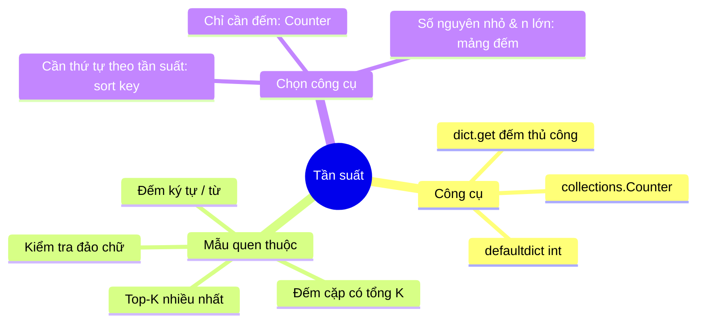
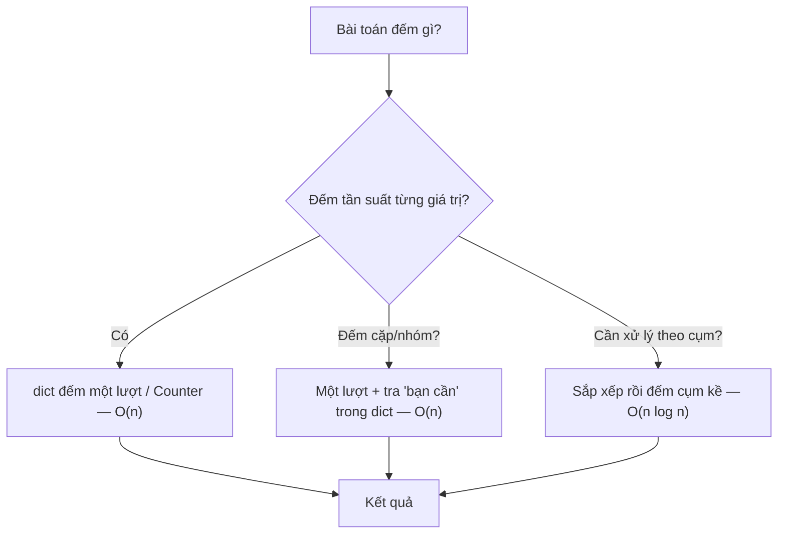

# Bài 30 — Tần Suất (Đếm & Thống Kê)

> 📚 **Dãy phẳng b1–b46 — Nền tảng + Thuật toán**

> 🏷️ **Nhóm bài:** Cấu trúc dữ liệu ứng dụng · **Mức độ:** ⭐⭐

---

## 🧠 Điều kiện tiên quyết

- [Bài 29 — Stack, Queue & Hashing](../b29-Stack-Queue-Hashing/bai.md)
- [Bài 15 — Dictionary (Từ Điển)](../b15-Dictionary/bai.md)
- [Bài 14 — Set (Tập Hợp)](../b14-Set/bai.md)
- [Bài 8 — Vòng Lặp For](../b08-Vong-Lap-For/bai.md)

---

## 🎯 Mục tiêu

Sau bài học này, học viên sẽ:

* ✅ Hiểu **tần suất (frequency)** là gì: mỗi giá trị **xuất hiện bao nhiêu lần**.
* ✅ Nắm khuôn mẫu **đếm bằng dict** — vũ khí đếm chuẩn của mọi kỳ thi.
* ✅ Dùng thành thạo `collections.Counter`: đếm nhanh, `most_common`, cộng/trừ.
* ✅ Giải được nhóm bài "đếm": đếm ký tự, top-K, đếm cặp/nhóm, kiểm tra đối xứng.
* ✅ Biết chọn **đếm bằng dict** hay **sắp xếp rồi đếm theo cụm** — tùy đề.

---

## 📖 Mở đầu

"Đếm" là **một nửa của mọi bài toán**. Trong thi HSG bạn sẽ liên tục gặp:

> *"Ký tự nào xuất hiện nhiều nhất?"* · *"Có bao nhiêu cặp tổng bằng K?"* · *"Từ nào lặp lại 3 lần?"* ·
> *"Hai xâu có phải đảo chữ của nhau?"*

Tất cả đều là **bài toán tần suất**. Và công cụ trả lời chúng rất gọn:
**một chiếc dict đếm** — hoặc món ăn sẵn của Python: `Counter`.

Nếu Bài 29 dạy bạn **cơ chế** bảng băm, thì bài này dạy **nghề dùng bảng băm để đếm** —
nghề được dùng nhiều nhất trong mọi kỳ thi.

---

## 💡 Ý tưởng trực quan

* **Phiếu bầu:** mỗi phần tử trong dãy là 1 lá phiếu; dict là thùng phiếu theo tên ứng viên;
  cuối cùng mỗi ứng viên có bao nhiêu phiếu = tần suất.
* **Sổ điểm danh:** giáo viên điểm danh từng bạn — "An: 1, Bình: 1, An: 2...";
  gặp tên đã có thì cộng thêm 1.
* **Bảng đếm tay:** đếm chữ cái trong một câu dài — nhanh nhất là gạch 5 gạch theo từng chữ
  (đó chính là `dict[str, int]`).



---

## 📚 Kiến thức

### 1. Tần suất là gì?

**Tần suất** của giá trị `x` trong dãy = số lần `x` xuất hiện.

```python
a = ["an", "binh", "an", "chi", "an"]
# tần suất: an → 3, binh → 1, chi → 1
```

Công cụ "ngây thơ" Python có sẵn: `a.count(x)` — nhưng **đừng dùng nó trong vòng lặp**:

```python
for x in a:
    print(a.count(x))     # ❌ mỗi count là O(n) → tổng O(n²)
```

Cách chuẩn: **đếm một lượt bằng dict** — O(n).

### 2. Khuôn mẫu đếm bằng dict (quan trọng nhất bài này)

```python
a = ["an", "binh", "an", "chi", "an"]

dem = {}
for x in a:
    dem[x] = dem.get(x, 0) + 1     # chưa có → 0 + 1; có rồi → +1

print(dem)          # {'an': 3, 'binh': 1, 'chi': 1}
print(dem["an"])    # 3
```

Biến thể tương đương — tự khởi tạo khi gặp lần đầu:

```python
dem = {}
for x in a:
    if x not in dem:
        dem[x] = 0
    dem[x] += 1
```

Về hiệu năng hai bản như nhau (mỗi vòng 1–2 phép tra dict O(1)).

> 🧠 **Học thuộc lòng dòng này:** `dem[x] = dem.get(x, 0) + 1` — sẽ gõ nó hàng trăm lần trong sự nghiệp thi.

### 3. Counter — "máy đếm" của Python

```python
from collections import Counter

dem = Counter(a)                 # đếm tất cả trong 1 dòng
print(dem)                       # Counter({'an': 3, 'binh': 1, 'chi': 1})
print(dem["an"])                 # 3
print(dem["khong_co"])           # 0 — KHÔNG lỗi (khác dict thường!)
print(dem.most_common(1))        # [('an', 3)] — top 1 nhiều nhất
```

* `Counter` là **dict đặc biệt**: mặc định giá trị 0, có sẵn hàm thống kê.
* Đếm ký tự trong xâu cực nhanh: `Counter("banana")` → `Counter({'a': 3, 'n': 2, 'b': 1})`.
* Cộng/trừ hai bộ đếm: `dem1 + dem2` (gộp), `dem1 - dem2` (hiệu, bỏ ≤ 0).

### 4. Ba mẫu đếm quen thuộc

**(a) Đếm ký tự / từ:**

```python
from collections import Counter
s = "hom nay troi dep qua"
dem_chu = Counter(c for c in s if c != " ")
print(dem_chu.most_common(2))    # 2 ký tự nhiều nhất
```

**(b) Top-K nhiều nhất — sắp theo tần suất:**

```python
# Cách 1: most_common
top3 = Counter(a).most_common(3)

# Cách 2: tự sắp — kiểm soát khóa phụ (tần suất giảm dần, rồi giá trị tăng dần)
tu_sap = sorted(dem.items(), key=lambda kv: (-kv[1], kv[0]))
```

> 💡 Khi tần suất bằng nhau, đề thường yêu cầu khóa phụ (giá trị nhỏ trước / lớn trước / theo thứ tự xuất hiện)
> — đọc kỹ đề, chỉnh `key` cho khớp.

**(c) Đếm cặp có tổng K (dùng tần suất gặp trước đó):**

```python
# Đếm số cặp i < j có a[i] + a[j] == K — O(n) bằng dict tần suất
dem = {}
ans = 0
for x in a:
    ans += dem.get(K - x, 0)     # mọi số K-x ĐÃ GẶP trước ghép với x
    dem[x] = dem.get(x, 0) + 1
print(ans)
```

Đây chính là bản nâng cấp O(n) của bài vét cạn cặp đôi (Bài 26) —
**kỹ thuật một lượt + dict tra "bạn cần"** là mẫu thi cực phổ biến.

### 5. Đếm bằng dict vs sắp xếp rồi đếm theo cụm

Hai chiến lược đếm hay gặp:

| Chiến lược | Độ phức tạp | Khi dùng |
|---|---|---|
| Dict đếm từng lượt | O(n) | Đếm tần suất từng giá trị — mặc định |
| Sắp xếp rồi đếm cụm kề | O(n log n) | Cần "cụm giống nhau" + các xử lý theo cụm (vd: gộp dãy con giống) |

```python
# Đếm cụm sau khi sắp: mọi giá trị giống nhau đứng kề nhau
a.sort()
dem = []
i = 0
while i < n:
    j = i
    while j < n and a[j] == a[i]:
        j += 1
    dem.append((a[i], j - i))
    i = j
```

### 6. Idempotent: kiểm tra "đảo chữ" (anagram)

Hai xâu là đảo chữ của nhau ⟺ **bảng tần suất ký tự giống hệt**:

```python
Counter(s1) == Counter(s2)
```

Một dòng — nhờ tính chất "dict so sánh theo cặp khóa ↔ giá trị". Mẫu tương tự:
hai dãy "cùng đa tập" ⟺ `Counter(a) == Counter(b)`.

---

## 💻 Ví dụ

### Ví dụ 1 — Dễ: đếm ký tự xuất hiện nhiều nhất

> Đề: Cho xâu `s` (chữ thường, không dấu). In ký tự xuất hiện nhiều nhất; nếu hòa, in ký tự nhỏ hơn theo từ điển.

```python
from collections import Counter

s = input().strip()
dem = Counter(s)
max_lan = max(dem.values())
for c in "abcdefghijklmnopqrstuvwxyz":     # duyệt theo thứ tự từ điển → tự chọn ký tự nhỏ nhất khi hòa
    if dem[c] == max_lan:
        print(c, max_lan)
        break
```

**Phân tích:** O(n + 26). Duyệt bảng chữ cái theo thứ tự để xử lý "hòa thì chọn nhỏ hơn" — mẹo gọn.

### Ví dụ 2 — Trung bình: top-3 từ xuất hiện nhiều nhất trong đoạn văn

```python
from collections import Counter

doan = input().lower().split()        # tách từ + không phân biệt hoa thường
dem = Counter(doan)
for tu, lan in dem.most_common(3):
    print(tu, lan)
```

**Phân tích:** `split()` tách theo khoảng trắng; `Counter` đếm; `most_common(3)` lấy top.
Lưu ý đề có thể yêu cầu "loại bỏ dấu câu" — khi đó xử lý `replace` trước khi đếm.

### Ví dụ 3 — Khó: đếm cặp tổng chẵn O(n) (nâng cấp Bài 26)

> Đề: Đếm số cặp `i < j` có `a[i] + a[j]` chẵn, với `n ≤ 10⁵` (bản vét cạn O(n²) sẽ TLE).

```python
n = int(input())
a = list(map(int, input().split()))

chan = sum(1 for x in a if x % 2 == 0)
le = n - chan
print(chan * (chan - 1) // 2 + le * (le - 1) // 2)
```

**Phân tích:** dùng **tần suất theo tính chẵn/lẻ** thay vì duyệt cặp: đếm `chan`, `le` rồi tổ hợp.
Đúng như lời giải vét cạn (đã kiểm chứng bằng stress test ở Bài 26) nhưng **O(n)** — sống khỏe với n = 10⁵.

---

## 📊 Minh họa



---

## ⚠️ Những lỗi thường gặp

### Lỗi 1: Dùng `a.count(x)` trong vòng lặp

O(n²) — với n = 10⁵ là 10¹⁰ phép → TLE. **Sửa:** đếm một lượt bằng dict.

### Lỗi 2: Quên giá trị khởi tạo

```python
dem[x] += 1        # ❌ KeyError nếu x chưa có
```

**Sửa:** `dem[x] = dem.get(x, 0) + 1` hoặc `Counter` / `defaultdict(int)`.

### Lỗi 3: Sắp xếp mất "tần suất" 

```python
a.sort()
# rồi in a[:3] — ❌ đây là 3 giá trị nhỏ nhất, KHÔNG phải 3 giá trị nhiều nhất
```

**Sửa:** sắp **các cặp (giá trị, tần suất)** theo khóa tần suất: `sorted(dem.items(), key=...)`.

### Lỗi 4: Tưởng `most_common()` sắp chuẩn mọi đề

`most_common` khi hòa tần suất giữ **thứ tự xuất hiện đầu tiên**. Nếu đề yêu cầu khác
(nhỏ hơn trước, lớn hơn trước), phải tự `sorted` với khóa phụ.

---

## 🧪 Trường hợp đặc biệt

* **Dãy rỗng:** không có gì để đếm — trả 0 / in "KHONG".
* **Một giá trị duy nhất:** tần suất = n — `most_common(1)` trả đúng nó.
* **Số âm / số lớn:** dict không quan tâm giá trị — đếm vô tư.
* **`Counter` thiếu khóa:** `dem[la]` trả 0 (khác dict thường báo KeyError) — tiện nhưng đôi khi che lỗi gõ nhầm khóa.
* **Giá trị không băm được** (list): không làm khóa dict được → đổi sang tuple (ôn Bài 13).

---

## 🚀 Ứng dụng thực tế

* **Thống kê log:** đếm mã lỗi xuất hiện bao nhiêu lần, top IP truy cập.
* **Xử lý ngôn ngữ:** tần suất từ (word frequency), kiểm tra chính tả theo tần suất.
* **Trò chơi/quiz:** đếm số lần mỗi đáp án được chọn; phát hiện gian lận theo phân bố.
* **Dữ liệu:** histogram — nền tảng của mọi phân tích dữ liệu.

---

## 🧩 Bài tập

### Bài 1: Cài đặt cơ bản Frequency Counting Frequency Counting

* **Đề bài:** Viết hàm Frequency Counting_basic thực hiện đếm tần suất.
* **Input:** (theo đề bài)
* **Output:** (theo đề bài)
* **Gợi ý:** Cài đặt theo định nghĩa.

### Bài 2: Trace code Frequency Counting Frequency Counting

* **Đề bài:** Trace code: cho đoạn code mẫu Frequency Counting, hãy viết ra kết quả.
* **Input:** (theo đề bài)
* **Output:** (theo đề bài)
* **Gợi ý:** Chạy thủ từng bước.

### Bài 3: Điền khuyết Frequency Counting Frequency Counting

* **Đề bài:** Hoàn thiện hàm Frequency Counting đã cho sẵn.
* **Input:** (theo đề bài)
* **Output:** (theo đề bài)
* **Gợi ý:** Hoàn thiện code còn thiếu.

### Bài 4: So sánh Frequency Counting Frequency Counting

* **Đề bài:** So sánh 2 cách giải cho Tần suất.
* **Input:** (theo đề bài)
* **Output:** (theo đề bài)
* **Gợi ý:** So sánh ưu nhược điểm.

### Bài 5: Áp dụng trực tiếp Frequency Counting Frequency Counting

* **Đề bài:** Áp dụng thuật toán Frequency Counting trực tiếp.
* **Input:** (theo đề bài)
* **Output:** (theo đề bài)
* **Gợi ý:** Áp dụng trực tiếp thuật toán.

### Bài 6: Biến thể đơn giản Frequency Counting Frequency Counting

* **Đề bài:** Viết biến thể đơn giản của Frequency Counting.
* **Input:** (theo đề bài)
* **Output:** (theo đề bài)
* **Gợi ý:** Thay đổi tham số nhỏ.

### Bài 7: Debug Frequency Counting Frequency Counting

* **Đề bài:** Sửa lỗi trong code Frequency Counting cho trước.
* **Input:** (theo đề bài)
* **Output:** (theo đề bài)
* **Gợi ý:** Sửa try/except.

### Bài 8: Độ phức tạp Frequency Counting Frequency Counting

* **Đề bài:** Tính độ phức tạp O() của Frequency Counting.
* **Input:** (theo đề bài)
* **Output:** (theo đề bài)
* **Gợi ý:** Đếm phép toán.

### Bài 9: Kiểm tra hiểu Frequency Counting Frequency Counting

* **Đề bài:** Giải thích bước quan trọng của Frequency Counting.
* **Input:** (theo đề bài)
* **Output:** (theo đề bài)
* **Gợi ý:** Giải thích logic.

### Bài 10: Mở rộng Frequency Counting Frequency Counting

* **Đề bài:** Mở rộng Frequency Counting cho trường hợp mới.
* **Input:** (theo đề bài)
* **Output:** (theo đề bài)
* **Gợi ý:** Mở rộng tham số.

### Bài 11: Cài đặt đầy đủ Frequency Counting

* **Đề bài:** Viết chương trình hoàn chỉnh cho Frequency Counting.
* **Input:** (theo đề bài)
* **Output:** (theo đề bài)
* **Gợi ý:** Viết full code.

### Bài 12: Biến thể Frequency Counting

* **Đề bài:** Sửa thuật toán Frequency Counting.
* **Input:** (theo đề bài)
* **Output:** (theo đề bài)
* **Gợi ý:** Sửa logic core.

### Bài 13: Tối ưu hóa Frequency Counting

* **Đề bài:** Cải tiến độ phức tạp của Frequency Counting.
* **Input:** (theo đề bài)
* **Output:** (theo đề bài)
* **Gợi ý:** Cải tiến cấu trúc dữ liệu.

### Bài 14: Kết hợp Frequency Counting

* **Đề bài:** Kết hợp Frequency Counting với thuật toán khác.
* **Input:** (theo đề bài)
* **Output:** (theo đề bài)
* **Gợi ý:** Kết hợp 2 hàm.

### Bài 15: Trace phức tạp Frequency Counting

* **Đề bài:** Chạy trace thủ công cho Frequency Counting.
* **Input:** (theo đề bài)
* **Output:** (theo đề bài)
* **Gợi ý:** Viết nhật ký chạy.

### Bài 16: Biến thể ngược Frequency Counting

* **Đề bài:** Tìm input từ output cho Frequency Counting.
* **Input:** (theo đề bài)
* **Output:** (theo đề bài)
* **Gợi ý:** Ngược logic.

### Bài 17: Giới hạn lớn Frequency Counting

* **Đề bài:** Xử lý n lớn cho Frequency Counting.
* **Input:** (theo đề bài)
* **Output:** (theo đề bài)
* **Gợi ý:** Dùng cấu trúc dữ liệu phù hợp.

### Bài 18: So sánh thực tế Frequency Counting

* **Đề bài:** So sánh thực tế các thuật toán.
* **Input:** (theo đề bài)
* **Output:** (theo đề bài)
* **Gợi ý:** Dùng timeit.

### Bài 19: Mở rộng Frequency Counting

* **Đề bài:** Mở rộng Frequency Counting.
* **Input:** (theo đề bài)
* **Output:** (theo đề bài)
* **Gợi ý:** Thêm tham số.

### Bài 20: Áp dụng thực tế Frequency Counting

* **Đề bài:** Áp dụng Frequency Counting vào thực tế.
* **Input:** (theo đề bài)
* **Output:** (theo đề bài)
* **Gợi ý:** Áp dụng thực tế.

### Bài 21: Thiết kế thuật toán Frequency Counting

* **Đề bài:** Thiết kế thuật toán O() cho Frequency Counting.
* **Input:** (theo đề bài)
* **Output:** (theo đề bài)
* **Gợi ý:** Tham khảo CLRS.

### Bài 22: Chứng minh Frequency Counting

* **Đề bài:** Chứng minh đúng đắn cho Frequency Counting.
* **Input:** (theo đề bài)
* **Output:** (theo đề bài)
* **Gợi ý:** Dùng exchange argument.

### Bài 23: Giới hạn dưới Frequency Counting

* **Đề bài:** Chứng minh lower bound cho Frequency Counting.
* **Input:** (theo đề bài)
* **Output:** (theo đề bài)
* **Gợi ý:** Dùng adversary argument.

### Bài 24: Tối ưu cực hạn Frequency Counting

* **Đề bài:** Tối ưu Frequency Counting chạy trong time limit.
* **Input:** (theo đề bài)
* **Output:** (theo đề bài)
* **Gợi ý:** Profile + tối ưu.

### Bài 25: Biến thể nghiên cứu Frequency Counting

* **Đề bài:** Viết biến thể của Frequency Counting.
* **Input:** (theo đề bài)
* **Output:** (theo đề bài)
* **Gợi ý:** Tham khảo paper.

### Bài 26: Kết hợp nâng cao Frequency Counting

* **Đề bài:** Kết hợp 3 thuật toán cho Frequency Counting.
* **Input:** (theo đề bài)
* **Output:** (theo đề bài)
* **Gợi ý:** Phân chia rõ ràng.

### Bài 27: Đối kháng Frequency Counting

* **Đề bài:** Viết generator test phá Frequency Counting.
* **Input:** (theo đề bài)
* **Output:** (theo đề bài)
* **Gợi ý:** Sinh test adversarial.

### Bài 28: Mở rộng lý thuyết Frequency Counting

* **Đề bài:** Mở rộng định lý cho Frequency Counting.
* **Input:** (theo đề bài)
* **Output:** (theo đề bài)
* **Gợi ý:** Generalize định lý.

### Bài 29: Cài đặt production Frequency Counting

* **Đề bài:** Cài Frequency Counting production-ready.
* **Input:** (theo đề bài)
* **Output:** (theo đề bài)
* **Gợi ý:** Production checklist.

### Bài 30: Nghiên cứu mở Frequency Counting

* **Đề bài:** Đề xuất cải tiến mới cho Frequency Counting.
* **Input:** (theo đề bài)
* **Output:** (theo đề bài)
* **Gợi ý:** Đọc paper mới.


## ✅ Đáp án

> 💡 **Hãy tự làm bài tập trước** rồi mới mở đáp án.

<details>
<summary>✅ Bài 1: Đếm đầu tiên</summary>

```python
dem = {}
for v in a:
    dem[v] = dem.get(v, 0) + 1
print(dem.get(x, 0))
```

</details>

<details>
<summary>✅ Bài 2: Bảng chữ cái</summary>

```python
from collections import Counter
dem = Counter(s)
for c in sorted(dem):
    print(c, dem[c])
```

`sorted(dem)` sắp khóa theo thứ tự từ điển.

</details>

<details>
<summary>✅ Bài 3: Xuất hiện đúng 1 lần</summary>

```python
dem = {}
for v in a:
    dem[v] = dem.get(v, 0) + 1
print(*sorted(v for v, lan in dem.items() if lan == 1))
```

</details>

<details>
<summary>✅ Bài 4: Top-1 có khóa phụ</summary>

```python
best = None
for v, lan in dem.items():
    if best is None or lan > dem[best] or (lan == dem[best] and v < best):
        best = v
print(best)
```

Hoặc gọn: `min(dem, key=lambda v: (-dem[v], v))`.

</details>

<details>
<summary>✅ Bài 5: Anagram</summary>

```python
from collections import Counter
print("YES" if Counter(s1) == Counter(s2) else "NO")
```

</details>

<details>
<summary>✅ Bài 6: Ký tự nhiều nhất sau lọc</summary>

```python
dem = {}
for c in s:
    if c.isdigit() or c == " ":
        continue
    dem[c] = dem.get(c, 0) + 1
max_lan = max(dem.values())
for c in sorted(dem):
    if dem[c] == max_lan:
        print(c, max_lan)
        break
```

</details>

<details>
<summary>✅ Bài 7: Đếm cặp hiệu bằng K (O(n))</summary>

```python
dem = {}
ans = 0
for x in a:
    ans += dem.get(x - K, 0)     # các số đứng TRƯỚC x mà x - (số đó) = K
    dem[x] = dem.get(x, 0) + 1
print(ans)
```

Mỗi cặp hợp lệ được đếm đúng 1 lần tại thời điểm gặp phần tử sau. O(n).

</details>

<details>
<summary>✅ Bài 8: Từ lặp lại</summary>

```python
from collections import Counter
dem = Counter(doan.lower().split())
lap = [(tu, lan) for tu, lan in dem.items() if lan > 1]
lap.sort(key=lambda kv: (-kv[1], kv[0]))
for tu, lan in lap:
    print(tu, lan)
```

</details>

<details>
<summary>✅ Bài 9: Bộ ba đảo chữ</summary>

```python
from collections import Counter

dem = {}
ans = 0
for tu in ds_tu:
    khoa = "".join(sorted(tu))            # chữ ký: các chữ cái sắp lại — hai từ đảo chữ có CÙNG chữ ký
    ans += dem.get(khoa, 0)               # mỗi từ trước đó cùng chữ ký ghép thành 1 cặp
    dem[khoa] = dem.get(khoa, 0) + 1
print(ans)
```

Gọn hơn nữa: `khoa = tuple(sorted(tu))`. Cặp đếm một lượt — O(n · L log L) với L là độ dài từ.

</details>

---

## 🏠 Bài tập về nhà

> 📝 Làm vào vở (hoặc nộp GV). Đáp án chi tiết sẽ bổ sung trong đợt hoàn thiện.

1. **Đếm mọi thứ quanh bạn:** viết chương trình đếm tần suất ký tự trong một đoạn văn tự chọn ≥ 200 từ; in top-5 và nhận xét (chữ nào nhiều nhất? vì sao?).
2. **So sánh hai cách đếm:** đo thời gian `a.count(x)` trong vòng lặp vs dict một lượt với n = 100.000. Lập bảng chênh lệch — rút ra bài học O(n²) vs O(n).
3. **Biến thể bài 7:** làm lại bài "đếm cặp hiệu bằng K" nhưng đề yêu cầu in ra **một cặp chỉ số cụ thể** đầu tiên (không chỉ đếm) — nghĩ xem cần lưu gì thêm trong dict.

---

## 📎 Tra cứu nhanh — Khuôn mẫu & công cụ đếm

| Công cụ | Cú pháp | Ghi chú |
|---|---|---|
| Dict tự đếm | `dem[x] = dem.get(x, 0) + 1` | Khuôn mẫu chuẩn — học thuộc lòng |
| `defaultdict` | `from collections import defaultdict` → `dem = defaultdict(int)` → `dem[x] += 1` | Tự trả 0 khi thiếu khóa |
| `Counter` | `from collections import Counter` → `Counter(dãy)` | Đếm 1 dòng; `dem[la]` thiếu khóa → 0 |
| Lấy top-K | `dem.most_common(k)` | Trả list `[(giá trị, số lần), ...]` |
| Sắp có khóa phụ | `sorted(dem.items(), key=lambda kv: (-kv[1], kv[0]))` | Tần suất giảm, giá trị tăng |
| Tổng phiếu | `sum(dem.values())` | = độ dài dãy gốc |
| Cộng/trừ bộ đếm | `c1 + c2`, `c1 - c2` | `+` gộp; `-` hiệu (bỏ kết quả ≤ 0) |
| So đảo chữ | `Counter(s1) == Counter(s2)` | Một dòng |
| Đếm cụm sau sort | `sort()` + while đếm cụm kề | O(n log n) — khi cần xử lý theo cụm |
| Một lượt trả "bạn cần" | `ans += dem.get(K - x, 0)` trước khi `dem[x] += 1` | Đếm cặp/hai số — O(n) |

> 💡 Đọc thêm: [Bài 29 — Hashing](../b29-Stack-Queue-Hashing/bai.md) (cơ chế bên trong dict)
> · [Bài 45 — itertools](../b45-Itertools/bai.md) (groupby sau sort).

---

## ➡️ Điều hướng

**Vị trí:** `b30-Tan-Suat/bai.md`

**Bài tiếp theo:** [Bài 31 — Đệ Quy](../b31-De-Quy/bai.md)
