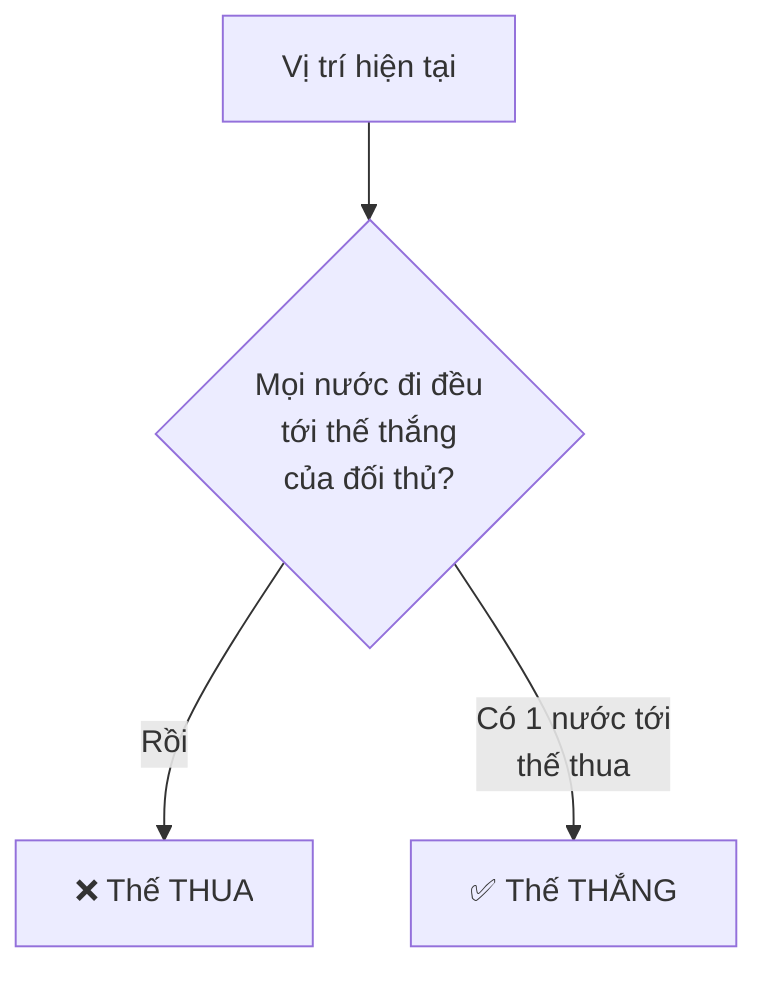

# Bài 44 — Lý Thuyết Trò Chơi: Nim & Số Grundy

> 📚 **Dãy phẳng b1–b44 — Nền tảng + Thuật toán**

---

## 🧠 Điều kiện tiên quyết

- [Bài 32 — Quy Hoạch Động](../b33-Quy-Hoach-Dong/bai.md) (truy hồi + memo — Grundy chính là DP!)
- [Bài 39 — Bitmask](../b40-Bitmask/bai.md) (XOR `^` dùng hằng ngày ở đây)
- [Bài 28 — Đệ Quy](../b29-De-Quy/bai.md)

---

## 🎯 Mục tiêu

Sau bài học này, học viên sẽ:

* ✅ Hiểu trò chơi công bằng (impartial game): 2 người, biết hết thông tin, không may rủi.
* ✅ Phân biệt thế thắng/thua (N-position/P-position) bằng truy hồi.
* ✅ Áp dụng định lý Nim: XOR các đống ≠ 0 thì người đi trước thắng + tìm nước đi.
* ✅ Tính số Grundy (mex) cho trò chơi tách đống, gộp nhiều trò con bằng XOR.
* ✅ Nhận diện đề game ("2 người chơi tối ưu", "không hòa") và tránh bẫy misère.

---

## 📖 Mở đầu

Cờ caro, cờ vua, oẳn tù tì thì khó. Nhưng một họ trò chơi — 2 người luân phiên,
biết hết mọi thứ, không xúc xắc, người không đi được thì thua — lại có **lý
thuyết giải hoàn toàn**: chỉ cần XOR! Họ này gọi là impartial game, và Nim là
vua của chúng.

---

## 💡 Ý tưởng trực quan

* **Thế thua (P-position):** "bẫy" — ai tới lượt ở đây (mà đối thủ chơi chuẩn)
  thì thua chắc. Ví dụ Nim 1 đống 0 viên: tới lượt mà hết đá → thua!
* **Thế thắng (N-position):** có ít nhất 1 nước đi tới thế thua của đối thủ.
* **XOR Nim:** "cân bằng" các đống theo bit. XOR = 0 là thế cân bằng (thua);
  nước đi thắng là **phá cân bằng của đối thủ rồi lập lại cân bằng mới**.



---

## 📚 Kiến thức

### 1. Truy hồi thắng/thua — định nghĩa duy nhất cần nhớ

```python
from functools import lru_cache

# Ví dụ: bốc 1-3 viên, ai bốc viên cuối thì thắng
@lru_cache(maxsize=None)
def thang(n):
    if n == 0:
        return False   # hết đá, tới lượt -> thua (base!)
    return any(not thang(n - k) for k in (1, 2, 3) if k <= n)

print([thang(i) for i in range(9)])
# [F,T,T,T,F,T,T,T,F] — thua khi n chia hết cho 4!
```

> Đây chính là DP (Bài 33) trá hình: trạng thái = số đá, truy hồi = "tồn tại
> nước đi tới thế thua". Mọi game impartial nhỏ đều giải được bằng đệ quy +
> memo này — chậm nhưng **luôn đúng**, dùng để kiểm chứng công thức nhanh!

### 2. Nim — XOR quyết định tất cả

> Có n đống đá, mỗi lượt lấy **bao nhiêu tùy thích** (≥ 1) từ **đúng 1 đống**.
> Lấy viên cuối thì thắng. Định lý: XOR mọi đống ≠ 0 → người đi trước thắng!

```python
def nim_thang(dong):
    xor = 0
    for d in dong:
        xor ^= d
    return xor != 0

assert nim_thang([3, 4, 5]) is True    # 3^4^5 = 2 ≠ 0
assert nim_thang([1, 4, 5]) is False   # 1^4^5 = 0
```

**Tìm nước đi thắng:** giảm 1 đống `d` thành `d ^ xor_tổng` (nếu nhỏ hơn d):

```python
def nuoc_thang_nim(dong):
    xor = 0
    for d in dong:
        xor ^= d
    for i, d in enumerate(dong):
        if d ^ xor < d:          # đống này giảm được về trạng thái cân bằng
            return (i, d ^ xor)  # (đống thứ i, để lại bấy nhiêu)
    return None

print(nuoc_thang_nim([3, 4, 5]))   # (0, 1): đống 3 -> 1 (vì 3^2=1)
```

Kiểm chứng: [1,4,5] có XOR = 1^4^5 = 0 ✔ (thế thua cho người tới lượt!).

### 3. Vì sao XOR đúng — trực giác 3 dòng (không chứng minh hình thức)

1. Từ thế XOR = 0, **mọi** nước đi đều làm XOR ≠ 0 (đổi 1 đống thì XOR đổi theo).
2. Từ thế XOR ≠ 0, **luôn tồn tại** 1 nước đi đưa về XOR = 0 (giảm đống có bit
   cao nhất của xor — công thức ở mục 2!).
3. Thế cuối (hết đá): XOR = 0. Vậy người luôn đưa về 0 sẽ đưa đối thủ tới chỗ
   hết đường → thắng. ∎

### 4. Số Grundy — Nim tổng quát (nhiều trò con gộp lại)

Khi mỗi lượt được chơi trên **1 trong nhiều đống độc lập** với luật riêng
(ví dụ mỗi đống là 1 trò bốc đá khác nhau), thay mỗi đống bằng **số Grundy**
của nó rồi XOR như Nim thường!

```python
from functools import lru_cache

@lru_cache(maxsize=None)
def grundy_boc123(n):
    if n == 0:
        return 0
    thay = {grundy_boc123(n - k) for k in (1, 2, 3) if k <= n}
    g = 0
    while g in thay:   # mex: số nguyên ≥ 0 NHỎ NHẤT vắng mặt
        g += 1
    return g

print([grundy_boc123(i) for i in range(11)])
# [0, 1, 2, 3, 0, 1, 2, 3, 0, 1, 2] — chu kỳ 4!
```

`mex` (minimum excludant) = số nhỏ nhất vắng mặt. Grundy(n) ≠ 0 ⟺ thế thắng
(khớp `thang(n)` ở mục 1 — kiểm chứng chéo được!).

### 5. Bẫy misère — luật "lấy cuối THUA" đổi mọi thứ!

Nim misère (lấy viên cuối thì **thua**): với mọi đống > 1 thì như Nim thường;
nhưng tàn cuộc toàn đống 1 thì chiến thuật đảo ngược (cố để đối thủ lấy viên
cuối)! Đề HSG hay gài đúng chỗ này — **đọc kỹ ai thắng khi hết đá** trước khi
áp công thức!

---

## 💻 Ví dụ

### Ví dụ 1 — Dễ: bốc đá 1–3 viên, ai thắng?

```python
import sys
from functools import lru_cache

@lru_cache(maxsize=None)
def thang(n):
    if n == 0:
        return False
    return any(not thang(n - k) for k in (1, 2, 3) if k <= n)

def main():
    data = sys.stdin.read().strip().split()
    if not data:
        return
    for x in map(int, data):
        print("First" if thang(x) else "Second")

main()
```

n = 7 → `thang(7)`: thử bốc 1 → thang(6)? ... truy hồi về base → True
(First). Quy luật n % 4 == 0 thì Second — nhưng code truy hồi đúng với mọi n
nhỏ mà không cần phát hiện quy luật!

### Ví dụ 2 — Thực tế: máy chơi Nim không thua (kèm nước đi)

```python
import sys

def nuoc_thang_nim(dong):
    xor = 0
    for d in dong:
        xor ^= d
    for i, d in enumerate(dong):
        if d ^ xor < d:
            return (i, d ^ xor)
    return None

def main():
    data = sys.stdin.read().strip().split()
    if not data:
        return
    dong = list(map(int, data))
    nuoc = nuoc_thang_nim(dong)
    if nuoc is None:
        print("Thua chac (the nao cung thua truoc doi thu chuan)")
    else:
        print(f"Lay dong {nuoc[0]} con {nuoc[1]} vien")

main()
```

Input `3 4 5` → `Lay dong 0 con 1 vien` (đống 3 → 1, XOR mới = 0 ✔).

### Ví dụ 3 — Khó: 3 đống bốc 1–3 viên — gộp bằng Grundy

> 3 đống (n1, n2, n3), mỗi lượt chọn 1 đống bốc 1–3 viên. Lấy viên cuối cùng
> (trên mọi đống) thì thắng. Ai thắng với (4, 7, 9)?

```python
import sys
from functools import lru_cache

@lru_cache(maxsize=None)
def grundy(n):
    if n == 0:
        return 0
    thay = {grundy(n - k) for k in (1, 2, 3) if k <= n}
    g = 0
    while g in thay:
        g += 1
    return g

def main():
    data = sys.stdin.read().strip().split()
    if not data:
        return
    dong = list(map(int, data))
    xor = 0
    for d in dong:
        xor ^= grundy(d)
    print("First" if xor != 0 else "Second")

main()
```

grundy(4) = 0, grundy(7) = 3, grundy(9) = 1 → XOR = 0^3^1 = 2 ≠ 0 → **First** ✔.
Mỗi đống là 1 "trò con", XOR các Grundy = Nim tổng quát (định lý
Sprague-Grundy — tên gọi để đọc editorial nước ngoài!).

---

## 📊 Minh họa

```
Bốc 1-3 viên, n = 7 (T = thắng, B = thua):
n:     0  1  2  3  4  5  6  7
dp:    B  T  T  T  B  T  T  T
Vì sao 4 thua? Bốc 1/2/3 -> 3/2/1 (đều T) -> mọi đường đều tới T -> B!
Vì sao 7 thắng? Bốc 3 -> 4 (B) -> đẩy đối thủ vào bẫy!

Nim [3,4,5] nhị phân (bit quyết định):
  3 = 011
  4 = 100
  5 = 101
XOR = 010 (bit 1 lẻ!) -> giảm đống có bit 1 (đống 3: 011 -> 001) -> cân bằng 0
```

---

## ⚠️ Những lỗi thường gặp

### Lỗi 1: Áp Nim cho luật khác (bốc tối đa k viên, nhiều đống...)

* Nim chuẩn: **1 đống/lượt, lấy bao nhiêu tùy thích**. Đổi luật (bốc ≤ k viên,
  bốc nhiều đống...) là bài khác (Grundy/DP) — áp XOR mù quáng là WA.

### Lỗi 2: Quên misère (lấy cuối thua)

* Đọc đề: ai lấy cuối thì THẮNG hay THUA? Sai 1 chữ là sai cả bài.

### Lỗi 3: Grundy không memo → bùng nổ mũ

* `grundy(n)` naive gọi lại chồng lấp như fib naive (Bài 29!) — `lru_cache`
  hoặc bảng bottom-up là bắt buộc.

### Lỗi 4: Nhầm P/N (ai không đi được thì thua, không phải "ai hết đá thắng")

* Định nghĩa gốc: **không còn nước đi → thua**. Với luật "lấy cuối thắng" thì
  hết đá = không đi được = thua ✔ khớp. Với misère thì khác — đọc đề!

### Lỗi 5: XOR bằng tay sai bit

* Viết nhị phân thẳng cột rồi XOR từng cột (chẵn bit 1 → 0). Nháp cẩu thả là
  tính sai xor → kết luận ngược!

---

## 🧪 Trường hợp đặc biệt

* **1 đống**: Nim 1 đống = luôn thắng (lấy hết!) trừ khi đống rỗng (thua).
  Grundy(0) = 0 là base của mọi truy hồi.
* **Mọi đống bằng nhau từng cặp** (a,a,b,b): XOR = 0 → thế thua (chiến thuật
  đối xứng: đối thủ làm gì, copy sang đống cặp!).
* **n = 0 viên ngay đầu**: người đi trước thua luôn (không có nước đi).
* **Luật bốc đúng 1 viên**: ai bốc cuối thắng ⟺ n lẻ (không cần lý thuyết!).

---

## 🚀 Ứng dụng thực tế

* AI game (minimax + alpha-beta là truy hồi thắng/thua tổng quát — ôn Bài 6!).
* Chia việc, đấu giá luân phiên (mô hình hóa thành game công bằng).
* Mật mã: XOR là phép nền của mã hóa (one-time pad).

---

## 🧩 Bài tập

### 🟢 Cơ bản (1–4)

**Bài 1 — Truy hồi tay.** Tính `thang(n)` với bốc 1–2 viên (không phải 1–3!),
n = 0..6, bằng tay. Quy luật thua là gì? (Đáp án: thua khi n % 3 == 0.)

**Bài 2 — XOR tay.** Tính XOR và kết luận ai thắng: [2, 2], [5, 5, 5],
[7, 8, 9]. (Đáp án: thua (0), thắng (5), thắng (7^8^9 = 6).)

**Bài 3 — Nước đi Nim.** [7, 8, 9] (XOR = 6): tìm nước thắng (đống nào, để lại
bao nhiêu). Kiểm chứng XOR sau nước đi = 0.

**Bài 4 — 1 đống đặc biệt.** Nim 1 đống n viên, mỗi lượt chỉ được lấy **số lẻ**
viên. Ai thắng theo n? (Không cần XOR — suy luận trực tiếp! Đáp án: First luôn
thắng với n ≥ 1? Kiểm: n=1 lấy 1 thắng; n=2 lấy 1 → còn 1 (lẻ) đối thủ lấy hết
thắng?? — tính lại cẩn thận!)

### 🟡 Hiểu sâu (5–8)

**Bài 5 — mex tay.** Tính Grundy bốc 1–2 viên (n = 0..6) bằng định nghĩa mex.
So với truy hồi thắng/thua (Grundy ≠ 0 ⟺ thắng?). (Đáp án: [0,1,2,0,1,2,0].)

**Bài 6 — Đối xứng song sinh.** Chứng minh: Nim 2 đống bằng nhau (a, a) là thế
thua (người sau luôn thắng) bằng chiến thuật "copy" (đối thủ lấy k ở đống này,
mình lấy k ở đống kia). Vì sao chiến thuật này luôn làm được?

**Bài 7 — Bốc tối đa k viên.** n đá, mỗi lượt bốc 1..k viên, lấy cuối thắng.
Chứng minh người thắng ⟺ n % (k+1) != 0 (quy hoạch + quan sát chu kỳ!).
Code DP kiểm chứng n ≤ 100, k = 5.

**Bài 8 — Misère 1 đống nhiều?** Nim misère 2 đống [1, 5] (lấy cuối thua).
Phân tích tay ai thắng (đừng áp XOR mù!). (Đáp án: First thắng? Thử: First lấy
hết đống 5 → còn [1], Second buộc lấy 1 → Second thua → First thắng ✔. Nhưng
[2, 2] misère thì sao? First lấy 1 ở 1 đống → [1,2]... phân tích tiếp!)

### 🔴 Vận dụng (9–12)

**Bài 9 — Grundy 2 trò gộp.** Đống A bốc 1–2 viên, đống B bốc 1–3 viên, mỗi lượt
chọn 1 đống. Tính Grundy từng loại (mex) rồi XOR, kết luận với A=5, B=7.
Code kiểm chứng bằng đệ quy thắng/thua trực tiếp trên trạng thái (a, b)!

**Bài 10 — Green Hackenbush tre.** (Bài đọc-hiểu kinh điển.) Cây tre có các đốt,
mỗi lượt chặt 1 đoạn (cả phần trên rơi theo). Grundy của đoạn tre dài n là n.
Suy ra: nhiều cây tre độc lập ⟺ Nim với đống = chiều cao! Giải thích vì sao
(cây tre dài n tương đương đống Nim n viên).

**Bài 11 — Đố chữ số.** 2 người viết số có n chữ số (không bắt đầu bằng 0),
người viết xong... (đề mở — tự ra luật thắng đơn giản: tổng các chữ số chẵn thì
First thắng?). Mô hình hóa thành game impartial + phân tích ai thắng với n = 1
(trò này mỗi "nước đi" là viết 1 chữ số — có bao nhiêu trạng thái?).

**Bài 12 — Viết editorial Nim.** Viết editorial 5 dòng cho bài Nim cơ bản
(phát biểu → XOR → nước đi → chứng minh 3 dòng → bẫy misère). So với editorial
bài "cặp tổng chẵn" (Bài 42 — bài 12 đáp án): editorial game khác editorial
tìm kiếm ở chỗ nào?

---

## ✅ Đáp án

> 💡 **Hãy tự làm bài tập trước** rồi mới mở đáp án.

<details>
<summary>✅ Bài 1: Truy hồi tay</summary>

Bốc 1–2 viên: thang(0) = B. thang(1): bốc 1 → 0 (B) → **T**. thang(2): bốc 2
→ 0 → **T**. thang(3): bốc 1 → 2 (T), bốc 2 → 1 (T) → mọi đường tới T → **B**.
thang(4): bốc 1 → 3 (B) ✔ → **T**. thang(5): → 4 (B) → **T**. thang(6): → 5,4
(cả T) → **B**. Dãy B,T,T,B,T,T,B — thua khi **n % 3 == 0** ✔ (mỗi lượt đổi
số dư mod 3, bên đưa về 0 mod 3 thắng).

</details>

<details>
<summary>✅ Bài 2: XOR tay</summary>

* [2, 2]: 2^2 = **0** → Second (thế thua cho người đi).
* [5, 5, 5]: 5^5^5 = **5** ≠ 0 → First.
* [7, 8, 9]: 7^8 = 15, 15^9 = **6** ≠ 0 → First.
* Viết nhị phân thẳng cột để khỏi nhầm (mục Lỗi 5!).

</details>

<details>
<summary>✅ Bài 3: Nước đi Nim</summary>

XOR = 6 (110₂). Cần giảm 1 đống để XOR về 0: xét đống có bit 2² (bit cao nhất
của 6): đống 7 (111) và 9 (1001)? Bit 4 (2²): 7 = 0111 (có bit 4 ✔), 9 = 1001
(không có bit 4)... kiểm: đống 7 → 7^6 = 1 < 7 ✔ → để lại **1**.
XOR mới: 1^8^9 = 0 ✔ (1^8 = 9, 9^9 = 0 ✔). Đáp án: **đống 7 còn 1 viên**.

</details>

<details>
<summary>✅ Bài 4: 1 đống đặc biệt</summary>

Luật: mỗi lượt lấy số **lẻ** viên, lấy cuối thắng. Phân tích:
n = 1: lấy 1 → thắng (First). n = 2: chỉ lấy được 1 → còn 1, đối thủ lấy 1
thắng → First **thua**. n = 3: lấy 1 → còn 2 (đối thủ ở thế thua n=2!) →
First **thắng**. n = 4: lấy 1 → còn 3 (thắng cho đối thủ ✗); lấy 3 → còn 1
(đối thủ lấy hết thắng ✗) → First **thua**!
Quy luật: **First thắng ⟺ n lẻ**. (Không cần XOR — suy luận trực tiếp từ luật
lẻ/chẵn: mỗi lượt đổi tính chẵn lẻ của đống còn lại!)

</details>

<details>
<summary>✅ Bài 5: mex tay</summary>

Bốc 1–2: g(0) = 0. g(1) = mex{0} = **1**. g(2) = mex{g(1),g(0)} = mex{1,0} =
**2**. g(3) = mex{g(2),g(1)} = mex{2,1} = **0**. g(4) = mex{0,2} = **1**...
Dãy [0,1,2,0,1,2,0] — chu kỳ 3. Khớp truy hồi thắng/thua: g ≠ 0 đúng ở n = 1,2,
4,5 (thắng), g = 0 ở n = 0,3,6 (thua) ✔ (Bài 1 đáp án!).

</details>

<details>
<summary>✅ Bài 6: Đối xứng song sinh</summary>

Vị trí (a, a). Đối thủ lấy k (> 0) ở 1 đống → (a−k, a). Mình lấy k ở đống kia
→ (a−k, a−k) — luôn làm được vì 2 đống bằng nhau và k ≤ a. Lặp lại: đối thủ
không bao giờ hết đường trước mình (mình luôn "gương" được), và game hữu hạn
→ đối thủ kẹt trước. Vậy (a,a) là thế thua ✔. Đây là chứng minh không cần XOR
mà vẫn chặt — và là trực giác gốc của "cân bằng" trong định lý Nim!

</details>

<details>
<summary>✅ Bài 7: Bốc tối đa k viên</summary>

```python
from functools import lru_cache

@lru_cache(maxsize=None)
def thang(n, k):
    if n == 0:
        return False
    return any(not thang(n - i, k) for i in range(1, min(k, n) + 1))

for k in (3, 5):
    assert [thang(n, k) for n in range(12)] == [(n % (k + 1)) != 0 for n in range(12)]
```

Thua đúng khi n % (k+1) == 0: từ bội của (k+1), bốc 1..k còn dư 1..k (thắng cho
đối thủ); từ số khác, bốc về bội gần nhất (đẩy đối thủ vào bẫy). Chu kỳ k+1 —
mẫu "modulo thắng" gặp trong hàng loạt game lấy đá!

</details>

<details>
<summary>✅ Bài 8: Misère 1 đống nhiều?</summary>

[1, 5] (lấy cuối thua): First lấy hết đống 5 → [1] → Second buộc lấy viên cuối
→ Second thua → First **thắng** ✔.

[2, 2]: thử mọi nước của First (brute force kiểm chứng!):
* First lấy 1 → còn [1, 2]. Second **lấy hết** đống 2 → còn [1].
  First buộc lấy viên cuối → First **thua**.
* First lấy hết 1 đống → còn [2]. Second lấy 1 → còn [1].
  First buộc lấy viên cuối → First **thua**.
* Mọi nước đều thua → [2, 2] là thế **thua** cho người đi!

Bẫy tư duy ở đây: trực giác "lấy ít để nhường viên cuối cho đối thủ" sai —
Second luôn có nước "lấy hết 1 đống" đảo ngược tình thế. Bài học misère đắt giá:
**không có công thức tắt** (XOR vô dụng ở tàn cuộc!), chỉ có phân tích vét cạn
từng nhánh + brute force kiểm chứng. Đề HSG gài misère đúng để bắt ai học vẹt!

</details>

<details>
<summary>✅ Bài 9: Grundy 2 trò gộp</summary>

```python
from functools import lru_cache

@lru_cache(maxsize=None)
def g12(n):   # bốc 1-2
    if n == 0:
        return 0
    s = {g12(n - k) for k in (1, 2) if k <= n}
    return next(g for g in range(9) if g not in s)

@lru_cache(maxsize=None)
def g123(n):  # bốc 1-3
    if n == 0:
        return 0
    s = {g123(n - k) for k in (1, 2, 3) if k <= n}
    return next(g for g in range(9) if g not in s)

# A=5 (bốc 1-2): g12 = 2. B=7 (bốc 1-3): g123 = 3. XOR = 2^3 = 1 ≠ 0 -> First
assert (g12(5) ^ g123(7)) != 0
```

Kiểm chứng độc lập bằng đệ quy trực tiếp trên (a, b):

```python
@lru_cache(maxsize=None)
def thang2(a, b):
    if a == 0 and b == 0:
        return False
    for na in range(a):
        if a - na <= 2 and not thang2(na, b):
            return True
    for nb in range(b):
        if b - nb <= 3 and not thang2(a, nb):
            return True
    return False

assert thang2(5, 7) is True   # khớp Grundy ✔
```

Hai cách độc lập cùng đáp án → tự tin tuyệt đối (triết lý kiểm chứng chéo —
ôn Bài 42 stress test!).

</details>

<details>
<summary>✅ Bài 10: Green Hackenbush tre</summary>

Cây tre dài n: chặt ở đốt k (1..n) thì đoạn trên (dài n−k) rơi theo → còn đoạn
dài k−1. Các "nước đi" dẫn tới tre dài 0..n−1 — đúng tập {0..n−1} → mex = **n**.
Vậy tre dài n ⟺ đống Nim n viên! Nhiều cây tre = nhiều đống Nim → XOR chiều cao.
(Ví dụ tre 3, 4, 5: 3^4^5 = 2 ≠ 0 → First ✔ — cùng con số với ví dụ Nim ở mục 2!)

</details>

<details>
<summary>✅ Bài 11: Đố chữ số</summary>

Một cách ra đề cụ thể: viết số n chữ số (chữ đầu ≠ 0), ai viết chữ số cuối thì
dừng; First thắng nếu tổng các chữ số **chẵn**. Phân tích n = 1: First viết 1
chữ số 0–9 (đầu ≠ 0 nên 1–9): chọn chẵn thì thắng ngay → First **luôn thắng**
(chọn 2!). n = 2: First viết chục a (1–9), Second viết đơn vị b (0–9); tổng chẵn
⟺ cùng chẵn/lẻ. Second (đi sau, thấy a) luôn chọn b cùng tính chẵn lẻ → Second
**luôn thắng**! Mẫu "người sau thắng bằng chiến thuật gương/đáp ứng" — gặp hoài
trong game viết số!

</details>

<details>
<summary>✅ Bài 12: Viết editorial Nim</summary>

> **Nim cơ bản.** n đống, mỗi lượt lấy tùy ý 1 đống, lấy cuối thắng. Tính XOR
> mọi đống: ≠ 0 → First thắng (luôn có nước về XOR 0: giảm đống có bit cao nhất);
> = 0 → Second thắng (mọi nước đi phá cân bằng, First lập lại giùm). O(n).
> Bẫy: luật misère (lấy cuối thua) đổi đáp án tàn cuộc!

Editorial game vs editorial tìm kiếm: game cần **bất biến thắng/thua**
(XOR = 0 là bẫy — chứng minh mọi nước đi ra/vào), tìm kiếm cần **bất biến vòng
lặp + độ phức tạp**. Cùng là "vì sao đúng", nhưng đối tượng chứng minh khác nhau!

</details>

---

## 🧠 Thử thách

**Thử thách HSG:** Dawson's Kayles (đề thi quốc tế): hàng n pins, mỗi lượt hạ
1 pin và 2 pin kề nó "mất lượt" (không được dùng nữa), hạ pin cuối thì thắng.
Tính Grundy đến n = 52 bằng DP + phát hiện chu kỳ (từ n nào đó tuần hoàn chu kỳ
34!). *Gợi ý: G(n) = mex{G(k) XOR G(n−2−k)} với mọi k (hạ pin k, tách 2 đoạn);
tính đến 200, tìm chu kỳ — đây là bài Grundy "hàng thật" trong OI!*

---

## 📝 Tóm tắt

| Khái niệm | Nội dung |
|---|---|
| ⚖️ P/N | Không đi được thì thua; có nước tới P thì N |
| ➕ Nim | XOR ≠ 0 thắng; nước đi: giảm về XOR 0 |
| 🔢 Grundy/mex | Số nhỏ nhất vắng mặt; XOR nhiều trò con |
| ⚠️ Misère | Lấy cuối thua — đọc đề, đừng áp mù! |

---

## ➡️ Điều hướng

**Vị trí:** `b44-Ly-Thuyet-Tro-Choi/bai.md`

🏆 **Bạn đã hoàn thành toàn bộ track Thuật toán (Bài 1–43)!** Ôn lại
[Bài 24 — Tư Duy Thuật Toán](../b24-Tu-Duy-Thuat-Toan/bai.md) với con mắt mới,
hoặc sang Nhánh 03 — Thực Chiến.