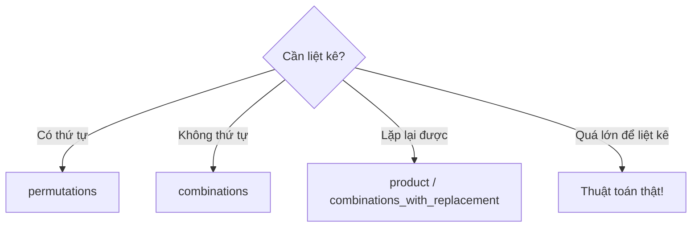

# Bài 45 — itertools: Hộp Đồ Nghề Vòng Lặp Cho Thi Đấu

> 📚 **Dãy phẳng b1–b46 — Nền tảng + Thuật toán**

> 🏷️ **Nhóm bài:** Công cụ · itertools cho thi đấu

---

## 🧠 Điều kiện tiên quyết

- [Bài 33 — Hai Con Trỏ](../b33-Hai-Con-Tro/bai.md) (duyệt thông minh)
- [Bài 32 — Quay Lui](../b32-Quay-Lui/bai.md) (liệt kê thủ công — giờ học cách liệt kê có sẵn!)
- [Bài 10 — Hàm](../b10-Ham/bai.md)

---

## 🎯 Mục tiêu

Sau bài học này, học viên sẽ:

* ✅ Dùng `product/permutations/combinations` để liệt kê thay vì viết quay lui tay cho n nhỏ.
* ✅ Dùng `accumulate/groupby/islice/count/cycle/chain` thay vòng lặp thủ công.
* ✅ Hiểu iterator lười (lazy): không tốn nhớ, dùng 1 lần rồi hết!
* ✅ Biết khi nào itertools đủ (n nhỏ, vét cạn) và khi nào phải thuật toán thật.
* ✅ Tránh bẫy: `groupby` đòi sort trước, iterator dùng 1 lần, `permutations` bùng nổ giai thừa.

---

## 📖 Mở đầu

Bài Quay lui (29) dạy bạn tự viết liệt kê hoán vị/tổ hợp — tốt cho tư duy,
nhưng thi thật thì **dùng đồ có sẵn nhanh hơn**: module `itertools` của Python
liệt kê mọi thứ bằng code C (nhanh gấp chục lần vòng lặp Python), lại còn
**lười** (sinh từng cái một, không ngốn RAM).

Quy tắc: n nhỏ + cần liệt kê hết → `itertools`; n lớn → thuật toán thật
(nhị phân, DP, tham lam...). Nhầm 2 trường hợp này là TLE/WA!

---

## 💡 Ý tưởng trực quan

* **`product`**: tung 2 xúc xắc — mọi cặp mặt (6×6 = 36). `repeat=3` là 3 xúc xắc.
* **`permutations`**: xếp hàng chụp ảnh — thứ tự quan trọng (ABC ≠ ACB).
* **`combinations`**: bốc kẹo vào túi — thứ tự không quan trọng ({A,B} = {B,A}).
* **Iterator lười**: vòi nước — mở ra chảy từng giọt, hứng rồi thì hết (không
  "đọc lại" được!). Muốn giữ thì hứng vào xô (`list(...)`).



---

## 📚 Kiến thức

### 1. Ba hàm liệt kê — phân biệt 1 lần nhớ đời

```python
from itertools import product, permutations, combinations

print(list(product("AB", repeat=2)))
# [('A','A'), ('A','B'), ('B','A'), ('B','B')] — 2² = 4 (lặp được!)

print(list(permutations("ABC", 2)))
# [('A','B'), ('A','C'), ('B','A'), ('B','C'), ('C','A'), ('C','B')] — P(3,2) = 6

print(list(combinations("ABCD", 2)))
# [('A','B'), ('A','C'), ('A','D'), ('B','C'), ('B','D'), ('C','D')] — C(4,2) = 6
```

| Hàm | Thứ tự? | Lặp lại? | Số lượng (n,k) | Khi dùng |
|---|---|---|---|---|
| `product(*..., repeat=k)` | Có | Có | nᵏ | Mật khẩu, xâu nhị phân, lưới ô |
| `permutations(a, k)` | Có | Không | P(n,k) | Xếp chỗ, thử thứ tự |
| `combinations(a, k)` | Không | Không | C(n,k) | Chọn nhóm, tập con |
| `combinations_with_replacement` | Không | Có | C(n+k−1,k) | Chọn có lặp (đổi tiền xu!) |

> 💡 Công thức đếm chính là Big-O của liệt kê: P(10,4) = 5.040 (ổn),
> P(20,10) ≈ 6.7×10⁸ (chết!). Đếm trước khi liệt kê — 5 giây tính nhẩm cứu
> 1 bài TLE!

### 2. Lười (lazy) — sức mạnh và cái giá

```python
from itertools import permutations

p = permutations(range(20), 10)   # KHÔNG tốn RAM! (chưa tính gì cả)
print(next(p))                    # (0, 1, ..., 9) — tính khi cần
print(len(list(p)))               # 670790400 - 1 (đếm hết, lâu!)
# p đã cạn — dùng tiếp ra rỗng! Muốn dùng lại phải tạo mới.
```

* Lười = sinh khi cần → RAM O(1) dù liệt kê hàng tỉ cái.
* Giá phải trả: **dùng 1 lần** (iterator cạn là hết), không `len()` trực tiếp,
  không index `p[5]`. Cần giữ lại → `list(...)` (lúc đó mới tốn nhớ!).

### 3. `accumulate` — tổng dồn có sẵn (khỏi viết vòng lặp!)

```python
from itertools import accumulate
import operator

print(list(accumulate([1, 2, 3, 4])))              # [1, 3, 6, 10] (mặc định cộng)
print(list(accumulate([1, 2, 3, 4], operator.mul)))  # [1, 2, 6, 24] (nhân dồn!)
```

Dùng cho tổng tiền tố, max dồn (`max`), kiểm tra "đâu là lần đầu vượt K"...

### 4. `groupby` — gom nhóm LIÊN TIẾP (bẫy: phải sort trước!)

```python
from itertools import groupby

s = "aaabbc"
print([(k, len(list(g))) for k, g in groupby(s)])
# [('a', 3), ('b', 2), ('c', 1)] — đếm dãy con liên tiếp (run-length)!

s2 = "ababa"
print([(k, len(list(g))) for k, g in groupby(s2)])
# [('a',1),('b',1),('a',1),('b',1),('a',1)] — KHÔNG gộp 'a' rời nhau!
```

> ⚠️ `groupby` chỉ gom cái **kề nhau**. Muốn gom toàn cục (như Counter) thì
> `sorted()` trước — hoặc dùng luôn `Counter` (Bài 29)! Nhầm 2 cái này là bug
> "chạy đúng ví dụ, sai test ẩn" kinh điển.

### 5. `islice/count/cycle/chain` — vòng lặp vô hạn và nối

```python
from itertools import islice, count, cycle, chain

print(list(islice(count(10, 2), 4)))   # [10, 12, 14, 16] (đếm vô hạn, cắt 4)
print(list(islice(cycle("AB"), 5)))    # ['A','B','A','B','A'] (xoay vòng!)
print(list(chain([1, 2], [3])))        # [1, 2, 3] (nối nhiều dãy)
```

`count/cycle` vô hạn — **không bao giờ** `list()` trực tiếp (treo máy!),
luôn đi với `islice`. Cặp đôi này thay thế khéo léo nhiều vòng `while True`.

### 6. Cặp kề nhau — `pairwise` (3.10+) và cách tương đương

```python
from itertools import pairwise   # Python 3.10+ (3.9 dùng cách dưới!)
a = [1, 2, 4, 7]
print(list(pairwise(a)))          # [(1,2), (2,4), (4,7)]
print(list(zip(a, a[1:])))        # tương đương, chạy mọi phiên bản ✔
```

Dùng cho: hiệu kề nhau (ôn Bài 27 — bài 8!), kiểm tra tăng dần, so sánh chuỗi...

---

## 💻 Ví dụ

### Ví dụ 1 — Dễ: đếm PIN + liệt kê mật khẩu mini

```python
from itertools import permutations, combinations, product

# PIN 4 số phân biệt từ 0-9: P(10,4) cách
print(len(list(permutations(range(10), 4))))   # 5040

# Chọn 4 số không quan tâm thứ tự: C(10,4)
print(len(list(combinations(range(10), 4))))   # 210

# Mật khẩu 2 ký tự AB (lặp được): 2^2
print(list(product("AB", repeat=2)))
```

Hiểu số lượng trước khi code: P(10,4) = 5.040 liệt kê được; P(20,10) thì đừng!

### Ví dụ 2 — Thực tế: brute force TSP mini bằng permutations (n ≤ 10)

```python
import sys
from itertools import permutations

def main():
    data = sys.stdin.read().strip().split()
    if not data:
        return
    n = int(data[0])
    c = [list(map(int, data[1 + i * n:1 + (i + 1) * n])) for i in range(n)]
    tot = 10 ** 18
    for p in permutations(range(1, n)):   # cố định 0 đầu (đối xứng vòng!)
        s = c[0][p[0]]
        for i in range(len(p) - 1):
            s += c[p[i]][p[i + 1]]
        s += c[p[-1]][0]
        tot = min(tot, s)
    print(tot)

main()
```

**Giải thích:** cố định thành phố 0 ở đầu (tour xoay vòng tương đương nhau) →
chỉ (n−1)! hoán vị thay vì n!. n = 10 → 362.880 tour, mỗi tour O(n) → ~4×10⁶,
Python vài giây ✔. n = 12 → 4×10⁸ → TLE → phải DP bitmask (Bài 42)!

### Ví dụ 3 — Khó: chia kẹo + đếm bằng combinatorics (không liệt kê!)

> n kẹo **giống hệt nhau** chia cho k bạn (mỗi bạn ≥ 1 cái). Bao nhiêu cách?
> n ≤ 10⁹ (không liệt kê được!) — dùng công thức stars and bars: C(n−1, k−1).

```python
import sys
import math

def main():
    data = sys.stdin.read().strip().split()
    if not data:
        return
    n, k = map(int, data[:2])
    if k > n or k <= 0:
        print(0)
        return
    print(math.comb(n - 1, k - 1))   # stars and bars, O(k) — không liệt kê!

main()
```

Trực giác stars and bars: xếp n ngôi sao `***...`, chèn k−1 vách ngăn vào n−1
khe giữa → mỗi cách chèn là 1 cách chia: C(n−1, k−1). Với n nhỏ (≤ 12) có thể
kiểm chứng bằng `combinations_with_replacement` liệt kê thật!

---

## 📊 Minh họa

```
permutations("ABC", 2) — cây 3×2 = 6 lá:
        (gốc)
    A       B       C
   / \     / \     / \
  AB AC   BA BC   CA CB

combinations("ABCD", 2) — 6 lá (mỗi tập 1 lần):
  AB AC AD BC BD CD

product("AB", repeat=2) — 2² = 4 (cho lặp):
  AA AB BA BB
```

---

## ⚠️ Những lỗi thường gặp

### Lỗi 1: Liệt kê cái quá lớn (P(20,10)) → treo máy

* **Cách sửa:** đếm trước (`math.perm/comb`), quá ~10⁷ thì đổi thuật toán
  (DP/quay lui có tỉa/tham lam...).

### Lỗi 2: Dùng iterator đã cạn

```python
p = permutations("ABC", 2)
print(len(list(p)))   # 6 — cạn!
print(len(list(p)))   # 0 !!! (không báo lỗi, chỉ rỗng!)
```

### Lỗi 3: `groupby` không sort trước

* `"ababa"` không gộp 'a' rời nhau. Muốn đếm toàn cục: `sorted()` trước
  hoặc `Counter`.

### Lỗi 4: Nhầm product/permutations/combinations

* "Chọn 3 người trong 10" mà dùng `permutations` → đếm gấp 6 lần (3!),
  liệt kê thừa → TLE/WA. Hỏi: thứ tự có quan trọng? Lặp được không?

### Lỗi 5: `list()` vòng lặp vô hạn

* `list(count())`, `list(cycle("AB"))` → treo máy vĩnh viễn. Luôn `islice`!

---

## 🧪 Trường hợp đặc biệt

* **k = 0**: `permutations(a, 0)` → 1 tuple rỗng `[()]`; `combinations(a, 0)` →
  `[()]`. (Có đúng 1 cách "chọn không gì cả" — quy ước tổ hợp!)
* **k > n**: `permutations/combinations` → rỗng (không cách nào).
* **Phần tử trùng**: `permutations("AAB", 3)` ra 6 tuple nhưng chỉ 3 phân biệt!
  Muốn phân biệt: `set(...)` (tốn nhớ) hoặc quay lui có tỉa (Bài 32).
* **`accumulate` rỗng**: `list(accumulate([]))` → `[]` (không crash).

---

## 🚀 Ứng dụng thực tế

* Sinh test case (product mọi input biên), brute force kiểm chứng (so với tối ưu
  trong stress test — ôn Bài 44!), xếp lịch thử mọi thứ tự (n nhỏ), mã PIN/mật
  khẩu audit.

---

## 🧩 Bài tập

### Bài 1: Cài đặt cơ bản Itertools Itertools

* **Đề bài:** Viết hàm Itertools_basic thực hiện liệt kê tổ hợp.
* **Input:** (theo đề bài)
* **Output:** (theo đề bài)
* **Gợi ý:** Cài đặt theo định nghĩa.

### Bài 2: Trace code Itertools Itertools

* **Đề bài:** Trace code: cho đoạn code mẫu Itertools, hãy viết ra kết quả.
* **Input:** (theo đề bài)
* **Output:** (theo đề bài)
* **Gợi ý:** Chạy thủ từng bước.

### Bài 3: Điền khuyết Itertools Itertools

* **Đề bài:** Hoàn thiện hàm Itertools đã cho sẵn.
* **Input:** (theo đề bài)
* **Output:** (theo đề bài)
* **Gợi ý:** Hoàn thiện code còn thiếu.

### Bài 4: So sánh Itertools Itertools

* **Đề bài:** So sánh 2 cách giải cho Itertools.
* **Input:** (theo đề bài)
* **Output:** (theo đề bài)
* **Gợi ý:** So sánh ưu nhược điểm.

### Bài 5: Áp dụng trực tiếp Itertools Itertools

* **Đề bài:** Áp dụng thuật toán Itertools trực tiếp.
* **Input:** (theo đề bài)
* **Output:** (theo đề bài)
* **Gợi ý:** Áp dụng trực tiếp thuật toán.

### Bài 6: Biến thể đơn giản Itertools Itertools

* **Đề bài:** Viết biến thể đơn giản của Itertools.
* **Input:** (theo đề bài)
* **Output:** (theo đề bài)
* **Gợi ý:** Thay đổi tham số nhỏ.

### Bài 7: Debug Itertools Itertools

* **Đề bài:** Sửa lỗi trong code Itertools cho trước.
* **Input:** (theo đề bài)
* **Output:** (theo đề bài)
* **Gợi ý:** Sửa try/except.

### Bài 8: Độ phức tạp Itertools Itertools

* **Đề bài:** Tính độ phức tạp O() của Itertools.
* **Input:** (theo đề bài)
* **Output:** (theo đề bài)
* **Gợi ý:** Đếm phép toán.

### Bài 9: Kiểm tra hiểu Itertools Itertools

* **Đề bài:** Giải thích bước quan trọng của Itertools.
* **Input:** (theo đề bài)
* **Output:** (theo đề bài)
* **Gợi ý:** Giải thích logic.

### Bài 10: Mở rộng Itertools Itertools

* **Đề bài:** Mở rộng Itertools cho trường hợp mới.
* **Input:** (theo đề bài)
* **Output:** (theo đề bài)
* **Gợi ý:** Mở rộng tham số.

### Bài 11: Cài đặt đầy đủ Itertools

* **Đề bài:** Viết chương trình hoàn chỉnh cho Itertools.
* **Input:** (theo đề bài)
* **Output:** (theo đề bài)
* **Gợi ý:** Viết full code.

### Bài 12: Biến thể Itertools

* **Đề bài:** Sửa thuật toán Itertools.
* **Input:** (theo đề bài)
* **Output:** (theo đề bài)
* **Gợi ý:** Sửa logic core.

### Bài 13: Tối ưu hóa Itertools

* **Đề bài:** Cải tiến độ phức tạp của Itertools.
* **Input:** (theo đề bài)
* **Output:** (theo đề bài)
* **Gợi ý:** Cải tiến cấu trúc dữ liệu.

### Bài 14: Kết hợp Itertools

* **Đề bài:** Kết hợp Itertools với thuật toán khác.
* **Input:** (theo đề bài)
* **Output:** (theo đề bài)
* **Gợi ý:** Kết hợp 2 hàm.

### Bài 15: Trace phức tạp Itertools

* **Đề bài:** Chạy trace thủ công cho Itertools.
* **Input:** (theo đề bài)
* **Output:** (theo đề bài)
* **Gợi ý:** Viết nhật ký chạy.

### Bài 16: Biến thể ngược Itertools

* **Đề bài:** Tìm input từ output cho Itertools.
* **Input:** (theo đề bài)
* **Output:** (theo đề bài)
* **Gợi ý:** Ngược logic.

### Bài 17: Giới hạn lớn Itertools

* **Đề bài:** Xử lý n lớn cho Itertools.
* **Input:** (theo đề bài)
* **Output:** (theo đề bài)
* **Gợi ý:** Dùng cấu trúc dữ liệu phù hợp.

### Bài 18: So sánh thực tế Itertools

* **Đề bài:** So sánh thực tế các thuật toán.
* **Input:** (theo đề bài)
* **Output:** (theo đề bài)
* **Gợi ý:** Dùng timeit.

### Bài 19: Mở rộng Itertools

* **Đề bài:** Mở rộng Itertools.
* **Input:** (theo đề bài)
* **Output:** (theo đề bài)
* **Gợi ý:** Thêm tham số.

### Bài 20: Áp dụng thực tế Itertools

* **Đề bài:** Áp dụng Itertools vào thực tế.
* **Input:** (theo đề bài)
* **Output:** (theo đề bài)
* **Gợi ý:** Áp dụng thực tế.

### Bài 21: Thiết kế thuật toán Itertools

* **Đề bài:** Thiết kế thuật toán O() cho Itertools.
* **Input:** (theo đề bài)
* **Output:** (theo đề bài)
* **Gợi ý:** Tham khảo CLRS.

### Bài 22: Chứng minh Itertools

* **Đề bài:** Chứng minh đúng đắn cho Itertools.
* **Input:** (theo đề bài)
* **Output:** (theo đề bài)
* **Gợi ý:** Dùng exchange argument.

### Bài 23: Giới hạn dưới Itertools

* **Đề bài:** Chứng minh lower bound cho Itertools.
* **Input:** (theo đề bài)
* **Output:** (theo đề bài)
* **Gợi ý:** Dùng adversary argument.

### Bài 24: Tối ưu cực hạn Itertools

* **Đề bài:** Tối ưu Itertools chạy trong time limit.
* **Input:** (theo đề bài)
* **Output:** (theo đề bài)
* **Gợi ý:** Profile + tối ưu.

### Bài 25: Biến thể nghiên cứu Itertools

* **Đề bài:** Viết biến thể của Itertools.
* **Input:** (theo đề bài)
* **Output:** (theo đề bài)
* **Gợi ý:** Tham khảo paper.

### Bài 26: Kết hợp nâng cao Itertools

* **Đề bài:** Kết hợp 3 thuật toán cho Itertools.
* **Input:** (theo đề bài)
* **Output:** (theo đề bài)
* **Gợi ý:** Phân chia rõ ràng.

### Bài 27: Đối kháng Itertools

* **Đề bài:** Viết generator test phá Itertools.
* **Input:** (theo đề bài)
* **Output:** (theo đề bài)
* **Gợi ý:** Sinh test adversarial.

### Bài 28: Mở rộng lý thuyết Itertools

* **Đề bài:** Mở rộng định lý cho Itertools.
* **Input:** (theo đề bài)
* **Output:** (theo đề bài)
* **Gợi ý:** Generalize định lý.

### Bài 29: Cài đặt production Itertools

* **Đề bài:** Cài Itertools production-ready.
* **Input:** (theo đề bài)
* **Output:** (theo đề bài)
* **Gợi ý:** Production checklist.

### Bài 30: Nghiên cứu mở Itertools

* **Đề bài:** Đề xuất cải tiến mới cho Itertools.
* **Input:** (theo đề bài)
* **Output:** (theo đề bài)
* **Gợi ý:** Đọc paper mới.


## ✅ Đáp án

> 💡 **Hãy tự làm bài tập trước** rồi mới mở đáp án.

<details>
<summary>✅ Bài 1: Đếm trước khi liệt kê</summary>

* P(5,3) = 5·4·3 = **60**; C(5,3) = 60/6 = **10**; 2⁵ = **32**;
  C(5+3−1,3) = C(7,3) = **35**.
* Kiểm: `math.perm(5,3)`, `math.comb(5,3)`, `len(list(product('AB',repeat=5)))`...

</details>

<details>
<summary>✅ Bài 2: Liệt kê mật khẩu</summary>

```python
from itertools import product, permutations
print(list(product("AB", repeat=2)))      # AA, AB, BA, BB (4)
print(list(permutations("AB", 2)))        # AB, BA (2 — mất AA, BB!)
```

Không lặp thì mất đúng các mật khẩu có ký tự trùng (AA, BB).

</details>

<details>
<summary>✅ Bài 3: groupby tay</summary>

`"aaabbc"`: (a,[a,a,a]) → (b,[b,b]) → (c,[c]).
`"ababa"`: 5 nhóm đơn vì không có 2 ký tự giống nhau **kề nhau**.
Sửa: `sorted("ababa")` = "aaabb" → groupby ra (a,3),(b,2) ✔ (nhưng mất thứ tự
gốc — muốn đếm toàn cục giữ thứ tự? Dùng `Counter`!).

</details>

<details>
<summary>✅ Bài 4: accumulate</summary>

```python
from itertools import accumulate
import operator
assert list(accumulate([1, 2, 3, 4])) == [1, 3, 6, 10]
assert list(accumulate([1, 2, 3, 4], operator.mul)) == [1, 2, 6, 24]
assert list(accumulate([3, 1, 4, 1, 5], max)) == [3, 3, 4, 4, 5]
```

`accumulate` thắng khi cần dãy trung gian (không chỉ tổng cuối); chỉ cần tổng
cuối thì `sum()` đơn giản hơn!

</details>

<details>
<summary>✅ Bài 5: Tổ hợp có lặp</summary>

```python
from itertools import combinations_with_replacement
xu = [1, 2, 5]
cach = [c for k in range(1, 6)
        for c in combinations_with_replacement(xu, k)
        if sum(c) == 5]
assert sorted(cach) == [(1, 1, 1, 1, 1), (1, 1, 1, 2), (1, 2, 2), (5,)]
```

Phải duyệt mọi độ dài k (1..5 đồng), vì cách đổi có thể dùng 1–5 xu!
Kết quả đúng 4 cách ✔ (khớp DP đếm Bài 35!). Liệt kê để **hiểu**,
DP để **chạy lớn** (S = 10⁴ thì liệt kê chết!).

</details>

<details>
<summary>✅ Bài 6: Cặp kề</summary>

```python
try:
    from itertools import pairwise
except ImportError:   # Python 3.9
    pairwise = lambda a: zip(a, a[1:])

def tang_nghiem_ngat(a):
    return all(x < y for x, y in pairwise(a))

assert tang_nghiem_ngat([1, 2, 3])
assert not tang_nghiem_ngat([1, 2, 2, 3])
assert tang_nghiem_ngat([])   # all([]) = True (đúng rỗng!)
```

</details>

<details>
<summary>✅ Bài 7: Chuỗi con liên tiếp?</summary>

`combinations([1,2,3,4], 2)` ra (1,3) — cách nhau, không liên tiếp!
Dãy con liên tiếp phải là đoạn [l..r]:

```python
def day_con_lien_tiep(a):
    n = len(a)
    return [a[l:r + 1] for l in range(n) for r in range(l, n)]
```

O(n²) đoạn. Nhầm 2 khái niệm này là WA cả bài (ôn Bài 33: "liên tiếp" ⟺ đoạn)!

</details>

<details>
<summary>✅ Bài 8: islice + count</summary>

```python
from itertools import islice, count, cycle

print(list(islice(count(0, 2), 10)))   # 0,2,...,18 (10 số chẵn)
nguoi = ["An", "Binh", "Chi"]
lich = list(islice(zip(count(1), cycle(nguoi)), 10))
print(lich[0], lich[3], lich[9])
# (1, 'An') (4, 'An') (10, 'An') — xoay vòng 3 người, ngày đánh số từ 1
```

Chú ý: `zip(count(1), cycle(nguoi))` vô hạn cả 2 đầu — phải `islice(..., 10)`
bọc ngoài mới dừng! Quên `islice` là treo máy (lỗi 5!).

</details>

<details>
<summary>✅ Bài 9: TSP brute force</summary>

Ma trận 4 thành phố (Bài 42): đáp án **80**. n = 10: 9! = 362.880 tour × O(n)
≈ 4×10⁶ phép → Python ~2–5s (sát biên!). n = 12: 11! ≈ 4×10⁷ × 12 ≈ 5×10⁸ →
hàng phút/giờ → TLE → phải DP bitmask O(n²·2ⁿ) (Bài 42) hoặc branch-and-bound.

</details>

<details>
<summary>✅ Bài 10: PIN an toàn?</summary>

* PIN 4 số phân biệt: 5.040 khả năng / 10³/giây ≈ **5 giây** (!!).
* PIN 6 số bất kỳ: 10⁶ / 10³ = **1.000 giây ≈ 17 phút**.
* Kết luận: độ dài thắng số lượng ràng buộc — PIN 6 số thường an toàn hơn
  PIN 4 số "phức tạp". Bài học bảo mật thật: attacker không quan tâm quy tắc
  của bạn, chỉ quan tâm không gian tìm kiếm!

</details>

<details>
<summary>✅ Bài 11: Stars and bars kiểm chứng</summary>

```python
from itertools import combinations_with_replacement
import math

def liet_ke_chia_keo(n, k):
    # mỗi bạn 1 cái trước, còn n-k cái chia tự do (có lặp)
    return [c for c in combinations_with_replacement(range(k), n - k)]

n, k = 6, 3
assert len(liet_ke_chia_keo(n, k)) == math.comb(n - 1, k - 1) == 10
```

Mỗi bộ (bạn nhận cái thứ...) — đếm = C(n−1,k−1) ✔. n ≤ 8 liệt kê được;
n = 10⁹ thì chỉ công thức sống!

</details>

<details>
<summary>✅ Bài 12: Stress test bằng product</summary>

```python
from itertools import permutations, product

def my_sort(a):
    a = list(a)
    for i in range(1, len(a)):
        key = a[i]
        j = i - 1
        while j >= 0 and a[j] > key:
            a[j + 1] = a[j]
            j -= 1
        a[j + 1] = key
    return a

cases = [list(p) for p in permutations([1, 2, 3])]
cases += [list(p) for p in product([0, 1], repeat=3)]
for a in cases:
    assert my_sort(a) == sorted(a)
print(f"OK {len(cases)} test (6 hoán vị + 8 nhị phân, gồm trùng/rỗng/biên)")
```

14 test nhỏ mà bao phủ: đã sắp xếp, ngược, trùng nhau, toàn 0/1 — triết lý
stress test (Bài 44): nhỏ + hiểm hơn to + hiền!

</details>

---

## 🧠 Thử thách

**Thử thách HSG:** Đếm số xâu nhị phân độ dài n **không có "00" liên tiếp**
bằng 2 cách: (a) liệt kê `product("01", repeat=n)` + lọc (n ≤ 20),
(b) công thức Fibonacci F(n+2) (ôn Bài 32 — bài 10!). So sánh thời gian n = 25
và giải thích vì sao (a) chết còn (b) sống. (Đáp án: (a) 2²⁵ ≈ 33 triệu xâu —
treo; (b) O(n).)

---

## 📝 Tóm tắt

| Khái niệm | Nội dung |
|---|---|
| 🔀 product/permutations/combinations | Lặp/không, thứ tự/không — đếm trước khi liệt kê! |
| 🦥 Lazy | Sinh khi cần, dùng 1 lần, RAM O(1) |
| ➕ accumulate/groupby | Dồn, gom kề (sort trước nếu cần toàn cục!) |
| ♾️ islice/count/cycle | Vô hạn phải có islice chặn |
| 🤝 pairwise/zip | Cặp kề (hiệu, tăng, so sánh) |

---

## 🏠 Bài tập về nhà

> 📝 Làm vào vở (hoặc nộp GV). Đáp án chi tiết sẽ bổ sung trong đợt hoàn thiện.

1. **Liệt kê tổ hợp/hoán vị:** viết 3 bài (tổ hợp chập 3, hoán vị 4 phần tử, tích Descartes 2 dãy) bằng `itertools` 1 dòng.
2. **Giảm vòng lặp:** viết lại 5 vòng lặp lồng nhau cũ bằng `product`, `permutations`, `combinations`.
3. **Groupby + sort:** cho list 1000 từ, gom nhóm theo chữ cái đầu — `sorted + groupby` vs dict đếm.

---

## 📎 Tra cứu nhanh — product, permutations, combinations, accumulate, groupby

| Hàm | Việc | Ví dụ |
|---|---|---|
| `product(a, b)` | Tích Descartes | `product('ab', '12')` → `a1, a2, b1, b2` |
| `permutations(a, k)` | Hoán vị k phần tử | `permutations('abc', 2)` |
| `combinations(a, k)` | Tổ hợp chập k | `combinations('abc', 2)` |
| `accumulate(a)` | Tổng tiền tố (lazy) | `list(accumulate([1,2,3]))` → `[1,3,6]` |
| `groupby(a, key=)` | Gom nhóm kề (cần sort trước) | `groupby(sorted(a), key=lambda x: x[0])` |
| `islice(gen, k)` | Lấy k phần tử đầu (chặn vô hạn) | `islice(count(), 5)` → `0..4` |
| `count(start, step)` | Số vô hạn | `count(10, -1)` → `10,9,8...` |
| `cycle(a)` | Lặp vô hạn | `cycle('ab')` → `a,b,a,b...` |
| `chain(a, b)` | Nối iterator | `chain(a, b)` giống `a+b` cho iter |
| `pairwise(a)` | Cặp kề (3.10+) | `pairwise([1,3,6])` → `(1,3), (3,6)` |

**Ghi nhớ:** `itertools` là C tối ưu — nhanh hơn vòng lặp Python gấp chục lần; `groupby` **bắt buộc sort trước** nếu muốn gom toàn cục; iterator chỉ dùng **1 lần** — xong là hết!

---

## ➡️ Điều hướng

**Vị trí:** `b45-Itertools/bai.md`

**Bài tiếp theo:** [Bài 46 — Lý Thuyết Trò Chơi: Nim & Số Grundy](../b46-Ly-Thuyet-Tro-Choi/bai.md)